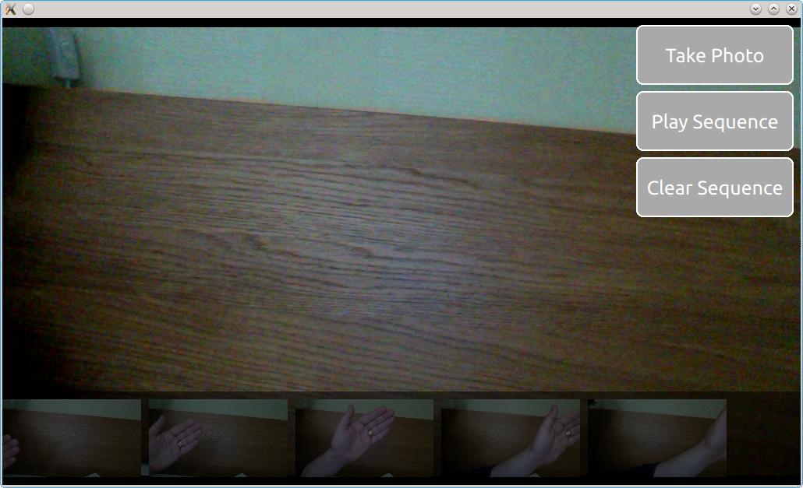

# 捕获图像

`Camera` 元素的关键特性之一是它可以用来拍照。我们将在一个简单的定格动画（stop-motion）应用程序中使用这一功能。通过构建这个应用程序，你将学会如何显示取景器（viewfinder）、在多个摄像头之间切换、拍摄照片以及跟踪已拍摄的照片。

用户界面如下所示。它由三个主要部分组成。背景中是取景器，右侧是一列按钮，底部是已拍摄图像的列表。其思路是拍摄一系列照片，然后点击 `Play Sequence` 按钮。这会回放这些图像，生成一个简单的定格动画短片。

## 取景器

摄像头的取景器部分使用一个 `VideoOutput` 元素作为 `CaptureSession` 的视频输出通道来实现。`CaptureSession` 又使用一个 `Camera` 组件来配置设备。这将显示来自摄像头的实时视频流。

<<< @/docs/ch11-multimedia/src/camera-capture/complete.qml#viewfinder

::: tip
通过使用专门的 `Camera` 属性，如 `exposureMode`、`whiteBalanceMode` 或 `zoomFactor`，你可以对摄像头的行为进行更多控制。
:::

## 已捕获图像列表

照片列表是一个水平方向的 `ListView`，显示来自 `ListModel`（名为 `imagePaths`）的图像。其背景使用了一个半透明的黑色 `Rectangle`。

<<< @/docs/ch11-multimedia/src/camera-capture/complete.qml#model-view

对于图像拍摄，`CaptureSession` 元素包含一组用于不同任务的子元素。要捕获静态图片，使用 `CaptureSession.imageCapture` 元素。调用 `captureToFile` 方法时，会拍摄一张图片并保存到用户的本地图片目录中。这将导致 `CaptureSession.imageCapture` 发出 `imageSaved` 信号。

<<< @/docs/ch11-multimedia/src/camera-capture/complete.qml#button-shot

在本例中，我们不需要显示预览图像，只需把生成的图像添加到屏幕底部的 `ListView` 中即可。如下例所示，所保存图像的路径会作为 `path` 参数随该信号一起提供。

<<< @/docs/ch11-multimedia/src/camera-capture/complete.qml#capture-session{6-8}

:::tip
要显示预览，可以连接到 `imageCaptured` 信号，并把 `preview` 信号参数用作 `source`，供 `Image` 元素使用。一个 `id` 信号参数会随 `imageCaptured` 和 `imageSaved` 一起发送。该值由 `capture` 方法返回。借助它，可以跟踪图像捕获的完整周期。这样，可以先使用预览，然后再用正确保存的图像替换它。不过，本示例并没有这样做。
:::

## 在多个摄像头之间切换

如果用户有多个摄像头，提供一种在它们之间切换的方式会很方便。可以结合使用 `MediaDevices` 元素和 `ListView` 来实现这一点。在我们的例子中，使用的是 `ComboBox` 组件：

<<< @/docs/ch11-multimedia/src/camera-capture/complete.qml#switching-devices{1-3,11}

`ComboBox` 的 `model` 属性被设置为 `MediaDevices` 的 `videoInputs` 属性。后一个属性包含可用视频输入的列表。然后，我们把控件的 `displayText` 设置为摄像头设备的描述（`captureSession.camera.cameraDevice.description`）。

最后，当用户切换视频输入时，会更新 cameraDevice 以反映这一变化：`captureSession.camera.cameraDevice = cameraComboBox.currentValue`。

## 回放

应用程序的最后一部分是实际的回放。它由一个 `Timer` 元素和一些 JavaScript 代码驱动。`_imageIndex` 变量用于跟踪当前显示的图像。当最后一张图像显示完毕后，回放停止。在这个示例中，播放序列时会使用 `root.state` 来隐藏用户界面的部分内容。

<<< @/docs/ch11-multimedia/src/camera-capture/complete.qml#playback
