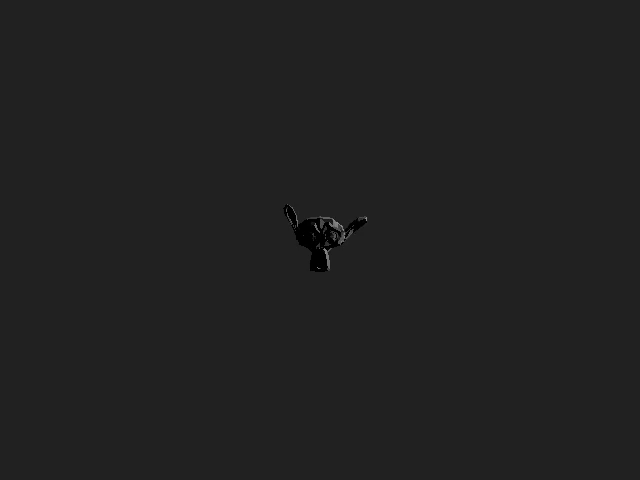
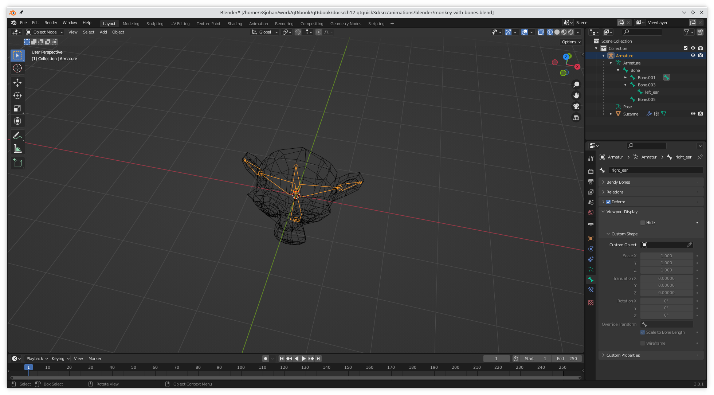

# 动画

有多种方法可以为 Qt Quick 3D 场景添加动画。最基本的一种是在场景中移动、旋转和缩放 ``Model`` 元素。然而在许多情况下，我们想修改的是实际的网格。对此有两种基本方法：变形动画（morphing animation）和骨骼动画（skeletal animation）。

变形动画让你创建若干目标形状，并可为它们分配不同的权重。按权重组合这些目标形状，就会产生一个变形（即 morph）后的形状。这常用于模拟软性材质的形变。

骨骼动画用于基于一副由骨骼构成的骨架的位置来摆出对象（例如身体）的姿势。这些骨骼会影响身体，从而把它变形为所需的姿势。

对于这两种动画，最常见的做法是在建模工具中定义变形目标形状和骨骼，然后用 _Balsam_ 工具导出到 QML。本章我们将为一个骨骼动画做这件事，而变形动画的做法是相似的。

# 骨骼动画

这个示例的目标是让 Suzanne——Blender 的猴头——用她的一只耳朵挥手。



骨骼动画有时被称为顶点蒙皮（vertex skinning）。基本上，一副骨架被放进网格内部，网格的顶点绑定到骨架上。这样，当骨架移动时，网格就被变形为各种姿势。

由于讲授 Blender 超出了本书的范围，你要找的关键词是 posing（摆姿势）和 armatures（骨架）。Armatures 是 Blender 对骨骼的称呼。有大量视频教程讲解如何做到这一点。下面的截图展示了 Blender 中带有 Suzanne 和 armatures 的场景。注意耳朵的 armatures 已被命名，以便我们能从 QML 中识别它们。



Blender 场景完成后，我们把它导出为 COLLADA 文件并转换为 QML 和网格，就像 _Working with Assets_（使用资源）一节中那样。得到的 QML 文件名为 ``Monkey_with_bones.qml``。

然后我们必须在 ``CMakeLists.txt`` 文件的 ``qt_add_qml_module`` 语句中引用这些文件：

```
qt_add_qml_module(appanimations
    URI animations
    VERSION 1.0
    QML_FILES main.qml Monkey_with_bones.qml
    RESOURCES meshes/suzanne.mesh
)
```

探索生成的 QML，我们注意到骨架是由 ``Skeleton`` 和 ``Joint`` 类型的 QML 元素搭建而成的。把它们当作 QML 中的代码来处理是可行的，但更常见的是在设计工具中创建它们。

<<< @/docs/ch12-qtquick3d/src/animations/Monkey_with_bones.qml#armature

``Skeleton`` 元素随后由 ``Model`` 元素的 ``skeleton`` 属性引用，其后是 ``inverseBindPoses`` 属性，把关节（joint）链接到模型。

<<< @/docs/ch12-qtquick3d/src/animations/Monkey_with_bones.qml#model

下一步是把新创建的 ``Monkey_with_bones`` 元素引入我们的主 ``View3D`` 场景：

<<< @/docs/ch12-qtquick3d/src/animations/main.qml#monkey

然后我们创建一个由两个 ``NumberAnimations`` 构成的 ``SequentialAnimation``，让耳朵来回摆动。

<<< @/docs/ch12-qtquick3d/src/animations/main.qml#animation

::: tip 注意
为了能够从 ``Monkey_with_bones`` 文件外部访问 ``Joint`` 的 ``eulerRotation.y``，我们需要把它暴露为一个顶层属性别名（property alias）。这意味着要修改一个生成的文件，这不太好，但它解决了问题。

<<< @/docs/ch12-qtquick3d/src/animations/Monkey_with_bones.qml#hack
:::

最终摆动的耳朵可以在下面欣赏：


如你所见，导入并使用在设计工具中创建的骨架是很方便的。这让从 QML 为复杂 3D 模型制作动画变得容易。
