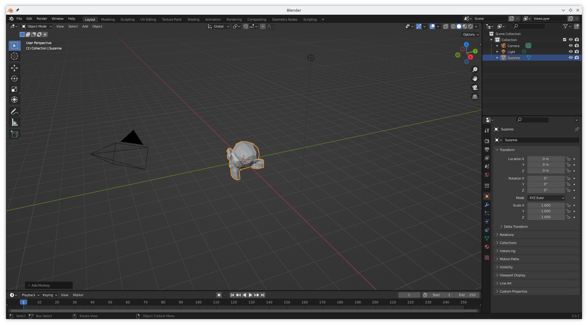
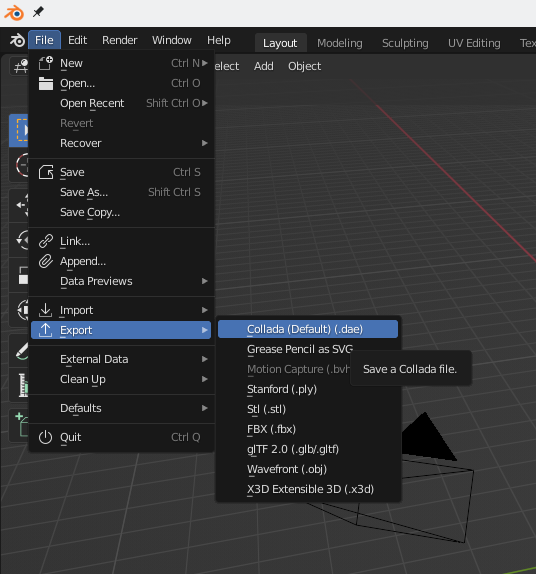
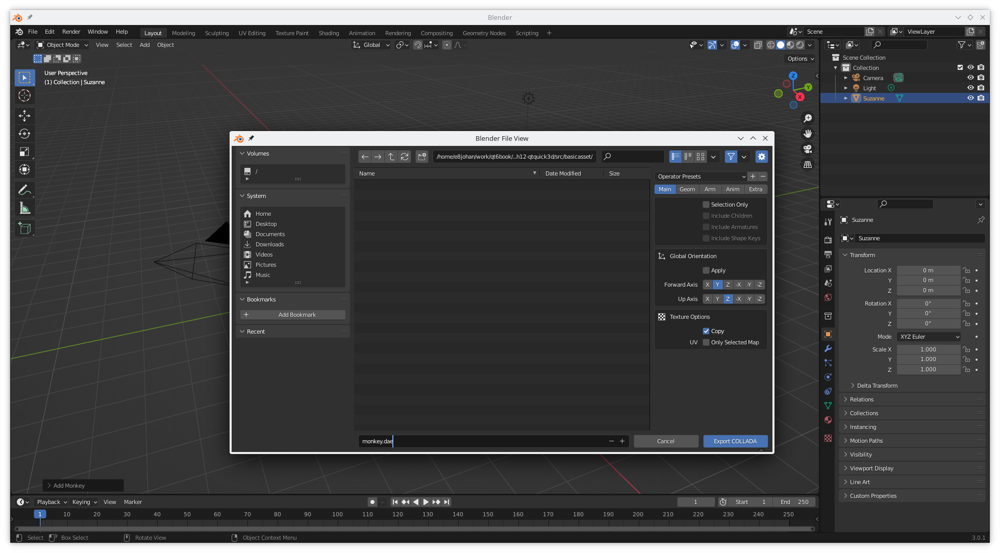
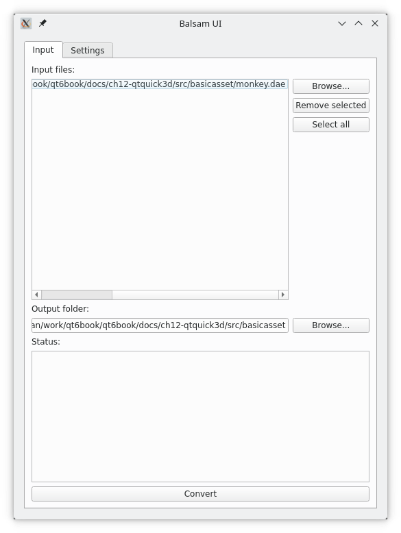
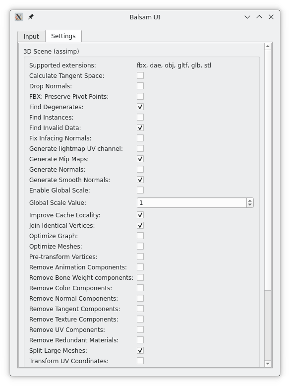
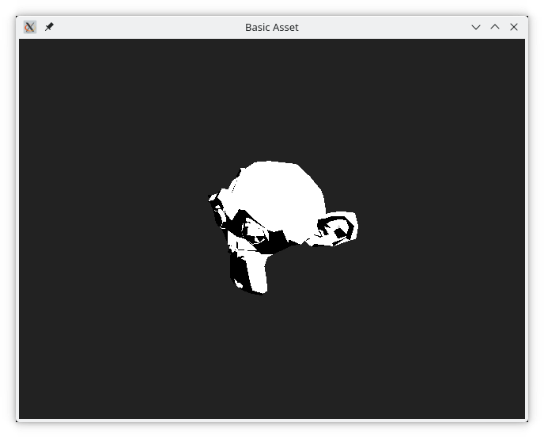
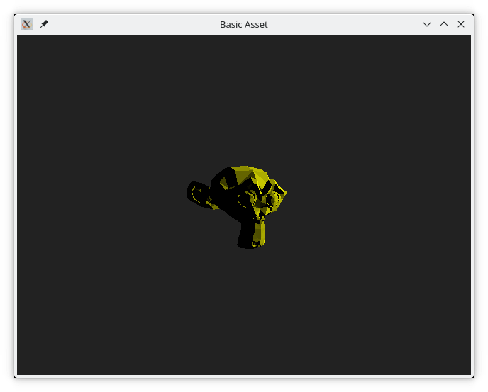

# 使用资源

处理 3D 场景时，内置网格很快就用腻了。取而代之的，是需要一条从建模工具到 QML 的良好流程。Qt Quick 3D 自带 Balsam 资源导入工具，用来把常见的资源格式转换为 Qt Quick 3D 友好的格式。

Balsam 的目的是让在 [Blender](https://www.blender.org/)、Maya 或 3ds Max 等常见工具中创建的资源可以轻松地在 Qt Quick 3D 中使用。Balsam 支持以下资源类型：

- COLLADA (``*.dae``)
- FBX (``*.fbx``)
- GLTF2 (``*.gltf``、``*.glb``)
- STL (``*.stl``)
- Wavefront (``*.obj``)

对于某些格式，纹理资源也可以导出为 Qt Quick 3D 友好的格式，前提是 Qt Quick 3D 支持所给的资源。

## Blender

为了生成一个可供导入的资源，我们将使用 Blender 创建一个包含猴头的场景。然后我们把它导出为 [COLLADA](https://en.wikipedia.org/wiki/COLLADA) 文件，以便用 Balsam 将其转换为 Qt Quick 3D 友好的文件格式。

Blender 可以从 [https://www.blender.org/](https://www.blender.org/) 获取，而精通 Blender 是另一本书的主题，所以我们将做最基础的事情。移除原来的立方体（用鼠标左键选中立方体，按 ``shift + x``，选择 _Delete_），添加网格（键盘上 ``shift + a``，选择 _Mesh_），然后选择添加猴头（从可用网格列表中选择 _Monkey_）。有一批视频教程演示如何做到这一点。最终带有猴头场景的 Blender 用户界面如下所示。



猴头就位后，进入 File -> Export -> COLLADA。



这会带你到 Export COLLADA 对话框，你可以在那里导出得到的场景。



::: tip 提示
Blender 场景和导出的 COLLADA 文件（``*.dae``）都可以在本章的示例文件中找到。
:::

## Balsam

COLLADA 文件保存到磁盘后，我们可以用 Balsam 把它准备好以在 Qt Quick 3D 中使用。Balsam 既可以作为命令行工具使用，也可以通过图形用户界面使用，即 ``balsamui`` 工具。图形工具只是命令行工具之上的一层薄壳，因此两种工具能做的事情没有差别。

我们先把 ``monkey.dae`` 文件添加到输入文件区（input files），并把输出文件夹设置为一个合理的路径。你的路径很可能与截图中所示的不同。



``balsamui`` 中的 _Settings_ 选项卡包含所有选项。它们都对应 ``balsam`` 工具的一个命令行选项。现在，我们把它们全部保留为默认值。



现在，回到 _Input_ 选项卡并点击 _Convert_。这将在用户界面的状态区产生如下输出：
    
```
Converting 1 files...
[1/1] Successfully converted '/home/.../src/basicasset/monkey.dae'

Successfully converted all files!
```

如果你是从命令行启动 ``balsamui`` 的，你还将在那里看到如下输出：

```
generated file:  "/home/.../src/basicasset/Monkey.qml"
generated file:  "/home/.../src/basicasset/meshes/suzanne.mesh"
```

这意味着 Balsam 生成了一个 ``*.qml`` 文件和一个 ``*.mesh`` 文件。

## Qt Quick 3D 资源

要在 Qt Quick 项目中使用这些文件，我们需要把它们添加到项目中。这在 ``CMakeLists.txt`` 文件的 ``qt_add_qml_module`` 宏中完成。如下所示，把这些文件添加到 ``QML_FILES`` 和 ``RESOURCES`` 小节。

```
qt_add_qml_module(appbasicasset
    URI basicasset
    VERSION 1.0
    QML_FILES main.qml Monkey.qml 
    RESOURCES meshes/suzanne.mesh
)
```

完成后，我们就可以像下图这样用 ``Monkey.qml`` 填充一个 ``View3D``。

<<< @/docs/ch12-qtquick3d/src/basicasset/main.qml#scene

``Monkey.qml`` 包含整个 Blender 场景，包括相机和一盏灯，因此结果是一个完整场景，如下所示。



有兴趣的读者建议去探索 ``Monkey.qml`` 文件。你会看到，它包含的是一个完全正常的 Qt Quick 3D 场景，由我们在本章已经用过的那些元素搭建而成。

::: tip 提示
由于 ``Monkey.qml`` 由工具生成，请不要手动修改该文件。如果你修改了，一旦需要用 Balsam 重新生成该文件，你的改动就会被覆盖。
:::

使用 Blender 中完整场景的替代做法，是在 Qt Quick 3D 场景中使用 ``*.mesh`` 文件。下面的代码演示了这一点。

这里，我们把一个 ``DirectionalLight`` 和一个 ``PerspectiveCamera`` 放进 ``View3D``，并通过 ``Model`` 元素把它与网格组合起来。这样，我们就可以从 QML 控制位置、缩放和光照。我们还为猴头指定了另一种黄色材质。

<<< @/docs/ch12-qtquick3d/src/basicasset/main.qml#mesh

得到的视图如下所示。



这演示了如何从 blender 这样的 3D 设计工具导出一个简单网格，转换为 Qt Quick 3D 格式，然后在 QML 中使用。有一点值得思考：我们可以原样导入整个场景（即使用 ``Monkey.qml``），也可以只使用资源（例如 ``suzanne.mesh``）。这让你在“简单导入场景”与“通过在 QML 中搭建场景来获得灵活性但增加复杂度”之间进行权衡取舍。
