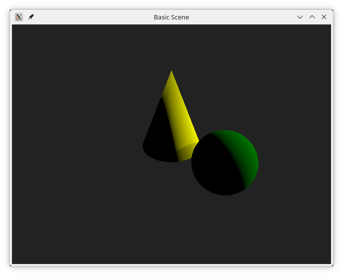
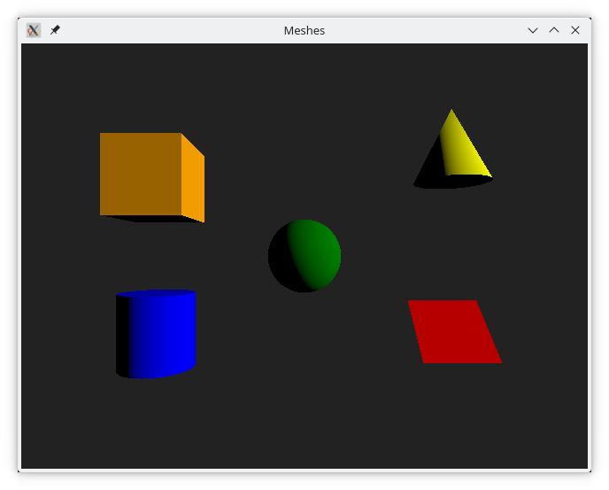
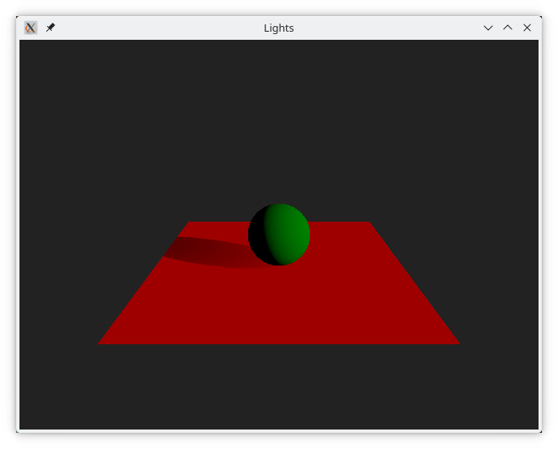
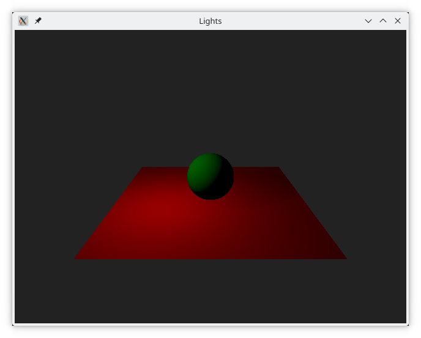
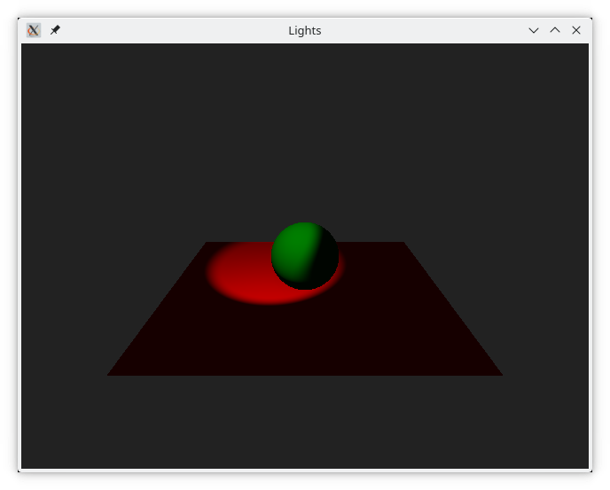

# 基础知识

本节将介绍 Qt Quick 3D 的基础知识，包括使用内置形状（网格）、光照，以及 3D 中的各种变换。

## 基础场景

一个 3D 场景由若干标准元素构成：

- ``View3D``：顶层 QML 元素，代表整个 3D 场景。
- ``SceneEnvironment``：控制场景的渲染方式，包括背景（即天空盒（sky box））的渲染方式。
- ``PerspectiveCamera``：场景中的相机。也可以使用 ``OrthographicCamera``，甚至使用带有自定义投影矩阵的自定义相机。

此外，场景通常还包含代表 3D 空间中物体的 ``Model`` 实例，以及光源。

我们将通过创建下图所示的场景，来了解这些元素如何协同工作。



首先，QML 代码以 ``View3D`` 作为主元素，填满整个窗口。我们还导入了 ``QtQuick3D`` 模块。

``View3D`` 元素可以视为普通 Qt Quick 元素，只是其内部会渲染 3D 内容。

```qml
import QtQuick
import QtQuick3D

Window {
    width: 640
    height: 480
    visible: true
    title: qsTr("Basic Scene")

    View3D {
        anchors.fill: parent

        // ...
    
    }
}
```

接着，我们为 ``SceneEnvironment`` 设置纯色背景。这是在 ``View3D`` 元素内部完成的。

<<< @/docs/ch12-qtquick3d/src/basicscene/main.qml#environment

``SceneEnvironment`` 还能控制许多其他渲染参数，不过目前我们只用它来设置纯色背景。

下一步是向场景中添加网格。网格代表 3D 空间中的一个物体。每个网格都通过一个 ``Model`` QML 元素创建。

模型可用于加载 3D 资源，不过 Qt Quick 3D 还提供了一些内置网格，让我们无需应对 3D 资源管理的复杂性即可上手。在下面的代码中，我们创建了一个 ``#Cone`` 和一个 ``#Sphere``。

除了网格的形状之外，我们还在 3D 空间中对它们进行定位，并为它们提供一种具有简单漫反射（diffuse）基础颜色的材质（material）。关于材质，我们将在[材质与光照]("Materials and Lights")一节中进一步讨论。

在 3D 空间中定位元素时，坐标用 ``Qt.vector3d(x, y, z)`` 表示：其中 `x` 轴控制水平移动，`y` 轴控制垂直移动，`z` 轴控制物体的远近。

默认情况下，`x` 轴的正方向向右，`y` 轴正方向向上，`z` 轴正方向指向屏幕外。我之所以说“默认”，是因为这取决于相机的投影矩阵。

<<< @/docs/ch12-qtquick3d/src/basicscene/main.qml#meshes

在场景中加入光照时，我们添加了一个 ``DirectionalLight``，它的工作方式很像太阳。它沿给定方向均匀地照亮场景。方向由 ``eulerRotation`` 属性控制，我们可以用它让光照方向绕各坐标轴旋转。将 ``castsShadow`` 属性设为 ``true``，就能让该光源产生阴影；从圆锥体上可以看到球体投下的阴影。

<<< @/docs/ch12-qtquick3d/src/basicscene/main.qml#light

最后一步是为场景添加相机。不同的视角需要不同的相机，若要实现真实感投影，则应使用 ``ProjectionCamera``。

在代码中，我们通过 ``position`` 属性放置相机。本可以用 ``eulerRotation`` 属性来指定相机朝向，但我们改为在 ``Component.onCompleted`` 信号处理器中调用 ``lookAt`` 方法。这样，相机在创建并初始化完成后就会旋转到指定方向。

<<< @/docs/ch12-qtquick3d/src/basicscene/main.qml#camera

生成的场景如下图所示。


总而言之，一个最小场景由以下部分组成：一个带有 ``SceneEnvironment`` 的 ``View3D``、可供观察的物体（例如带有网格的 ``Model``）、一个光源（例如 ``DirectionalLight``），以及用于观察的相机（例如 ``PerspectiveCamera``）。


## 内置网格

在前面的示例中，我们使用了内置的圆锥体和球体。Qt Quick 3D 提供以下内置网格：

- ``#Cube``
- ``#Cone``
- ``#Sphere``
- ``#Cylinder``
- ``#Rectangle``

它们都展示在下图中。（左上：立方体，右上：圆锥体，中央：球体，左下：圆柱体，右下：矩形）



::: tip 提示
需要注意的是，``#Rectangle`` 是单面的。也就是说，它只有一个方向可见。因此 ``eulerRotation`` 属性十分重要。
:::

在实际场景中，网格通常从设计工具导出，然后再导入 Qt Quick 3D 场景。我们将在[使用资源](assets.md)一节中更详细地介绍这一流程。


## 光源

与网格一样，Qt Quick 3D 也提供了一些预定义的光源。它们以不同方式为场景照明。

第一个是 ``DirectionalLight``，在前面的示例中我们已经用过。它的作用很像太阳，沿给定方向均匀地照亮整个场景。如果把 ``castsShadow`` 属性设为 ``true``，光源就会产生阴影，如下图所示。所有光源都有这个属性。



<<< @/docs/ch12-qtquick3d/src/lights/main.qml#directional

下一种光源是 ``PointLight``。它从空间中的给定点发出光线，然后根据 ``constantFade``、``linearFade`` 和 ``quadraticFace`` 属性的值逐渐衰减至黑暗，光照按 ``constantFade + distance * (linearFade * 0.01) + distance^2 * (quadraticFade * 0.0001)`` 计算。默认值为常量衰减和二次衰减取 ``1.0``，线性衰减取 ``0.0``，这意味着光按平方反比定律衰减。



<<< @/docs/ch12-qtquick3d/src/lights/main.qml#point

最后一种光源是 ``SpotLight``，它沿给定方向发出锥形光束，很像现实中的聚光灯。光锥由内锥和外锥组成。二者的宽度分别由 ``innerConeAngle`` 和 ``coneAngle`` 控制，取值范围为 0 到 180 度。

内锥中的光照表现很像 ``PointLight``，同样可以用 ``constantFade``、``linearFade`` 和 ``quadraticFace`` 属性控制。此外，光线越接近外锥就越暗，这一效果由 ``coneAngle`` 控制。



<<< @/docs/ch12-qtquick3d/src/lights/main.qml#spot

除了 ``castsShadow`` 属性外，所有光源还都有常用的 ``color`` 和 ``brightness`` 属性，用于控制所发光的颜色和强度。光源还有一个 ``ambientColor`` 属性，用于定义在被光源照亮之前施加到材质上的基础颜色。该属性默认为黑色，但可以用来为场景提供基础照明。

到目前为止的示例中，我们一次只使用了一个光源，但当然也可以在单个场景中组合使用多个光源。
