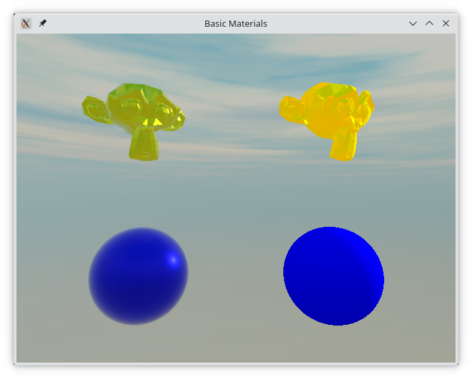
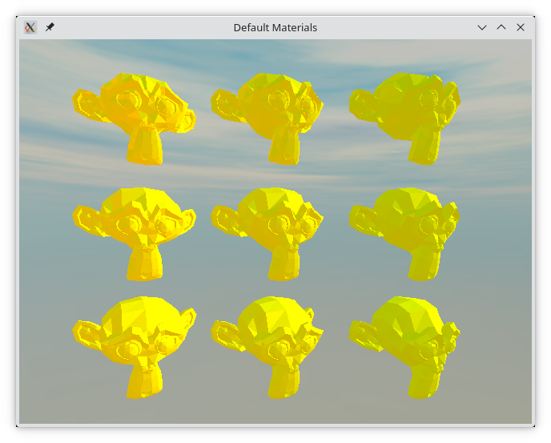
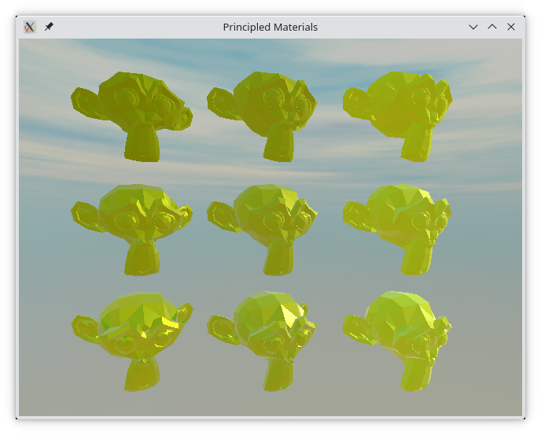

# 材质与光照

到目前为止，我们只使用了基础材质。要创建令人信服的 3D 场景，需要恰当的材质和更高级的光照。Qt Quick 3D 支持多种技术来实现这一点，在本节中我们将看到其中几种。

## 内置材质

首先来看内置材质。Qt Quick 3D 自带三种材质类型：``DefaultMaterial``、``PrincipledMaterial`` 和 ``CustomMaterial``。本章我们将涉及前两种，而后者允许你通过提供自己的顶点着色器和片元着色器来创建真正自定义的材质。

``DefaultMaterial`` 让你通过 ``specular``、``roughness`` 和 ``diffuseColor`` 属性来控制材质的外观。``PrincipledMaterial`` 让你通过 ``metalness``、``roughness`` 和 ``baseColor`` 属性来控制外观。

两种材质类型的示例如下所示，左边是 ``PrincipledMaterial``，右边是 ``DefaultMaterial``。

比较这两个 Suzanne，我们可以看到两种材质是如何设置的。

对于 ``DefaultMaterial``，我们使用了 ``diffuseColor``、``specularTint`` 和 ``specularAmount`` 属性。我们将在本节后面看到这些属性的变化如何影响对象的外观。

<<< @/docs/ch12-qtquick3d/src/basicmaterials/main.qml#suzannedefault

对于 ``PrincipledMaterial``，我们调整了 ``baseColor``、``metalness`` 和 ``roughness`` 属性。同样，我们将在本节后面看到这些属性的变化如何影响外观。

<<< @/docs/ch12-qtquick3d/src/basicmaterials/main.qml#suzanneprincipled

### Default 材质属性

下图展示了 default 材质在 ``specularAmount`` 和 ``specularRoughness`` 属性取不同值时的效果。

``specularAmount`` 从 ``0.8``（最左）经过 ``0.5``（中间）变化到 ``0.2``（最右）。

``specularRoughness`` 从 ``0.0``（上）经过 ``0.4``（中）变化到 ``0.8``（下）。

中间 ``Model`` 的代码如下所示。

<<< @/docs/ch12-qtquick3d/src/defaultmaterial/main.qml#middle

### Principled 材质属性

下图展示了 principled 材质在 ``metalness`` 和 ``roughness`` 属性取不同值时的效果。

``metalness`` 从 ``0.8``（最左）经过 ``0.5``（中间）变化到 ``0.2``（最右）。

``roughness`` 从 ``0.9``（上）经过 ``0.6``（中）变化到 ``0.3``（下）。

<<< @/docs/ch12-qtquick3d/src/principledmaterial/main.qml#middle

## 基于图像的光照

本节主示例中的最后一个细节是天空盒（skybox）。在这个示例中，我们使用图像作为天空盒，而不是单一颜色的背景。

要提供天空盒，如下方代码所示，把一个 ``Texture`` 赋给 ``SceneEnvironment`` 的 ``lightProbe`` 属性。这意味着场景接收基于图像的光照，也就是用天空盒来照亮场景。我们还调整了 ``probeExposure``，它用来控制通过探针（probe）暴露多少光，也就是场景会被照得多亮。在这个场景中，我们把光探针与一个 ``DirectionalLight`` 结合起来得到最终光照。

<<< @/docs/ch12-qtquick3d/src/basicmaterials/main.qml#skybox

除我们展示的内容外，光探针的朝向可以用 ``probeOrientation`` 向量来调整，``probeHorizon`` 属性可以用来把环境的下半部分调暗，模拟光来自上方（也就是来自天空）而非来自四面八方的效果。
