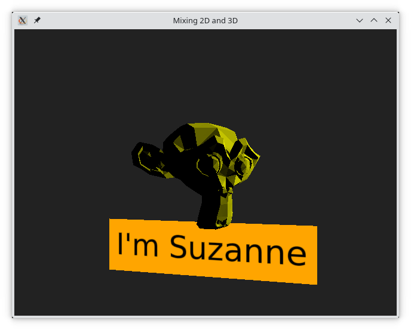

# 混合 2D 与 3D 内容

Qt Quick 3D 的构建目标就是良好地集成到用于构建动态 2D 内容的传统 Qt Quick 中。

## 2D 场景中的 3D 内容

把 3D 内容混入 2D 场景是直白的，因为 ``View3D`` 元素代表 Qt Quick 场景中的一个 2D 表面。

以这种方式把 3D 内容组合进 2D 场景时，有几个属性可能很值得关注。

首先是 ``View3D`` 的 ``renderMode``，它让你控制 3D 内容渲染在 2D 内容的后面、前面，还是与 2D 内容内联。它也可以渲染到一个离屏缓冲（off-screen buffer）上，然后与 2D 场景合成。

另一个属性是绑定到 ``View3D`` 的 ``environment`` 属性上的 ``SceneEnvironment`` 的 ``backgroundMode``。我们已经见过它被设置为 ``Color`` 或 ``SkyBox``，但它也可以被设置为 ``Transparent``，让你能透过 3D 场景看到 ``View3D`` 背后的任何 2D 内容。

在构建 2D 与 3D 的组合场景时，还有一点很好用：可以把多个 ``View3D`` 元素组合在单个 Qt Quick 场景中。例如，如果你想在一个场景中拥有多个 3D 模型，但它们是 2D 界面中彼此分离的部分，那么你可以把它们放进不同的 ``View3D`` 元素，并在 2D 的 Qt Quick 一侧处理布局。

## 3D 场景中的 2D 内容

要把 2D 内容放进 3D 场景，它需要被放置在一个 3D 表面上。Qt Quick 3D 的 ``Texture`` 元素有一个 ``sourceItem`` 属性，允许你把一个 2D Qt Quick 场景作为纹理（texture）集成到任意 3D 表面上。

另一种方法是把 2D Qt Quick 元素直接放进场景。这正是下面示例所用的方法，我们为 Suzanne 提供了一个姓名徽章。

我们在这里所做的是实例化一个 ``Node``，它在 3D 场景中充当锚点。然后我们把 ``Rectangle`` 和 ``Text`` 元素放进 ``Node`` 内部。这两个都是 2D Qt Quick 元素。随后我们可以通过 ``Node`` 元素的相应属性来控制 3D 的位置、旋转和缩放。

<<< @/docs/ch12-qtquick3d/src/mix2d3d/main.qml#2dnode
