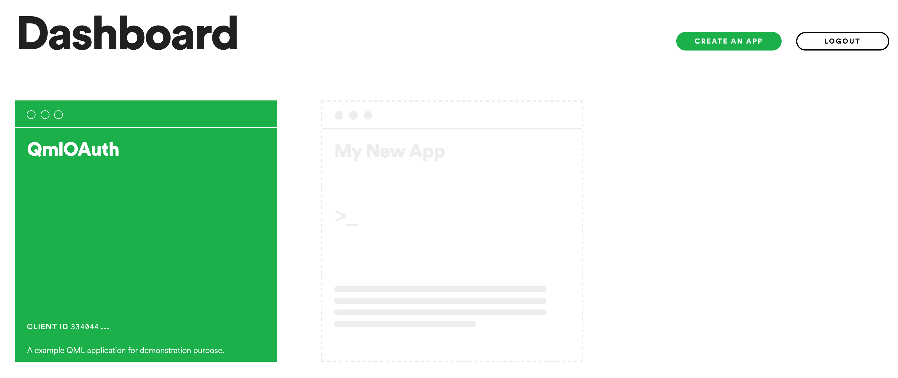
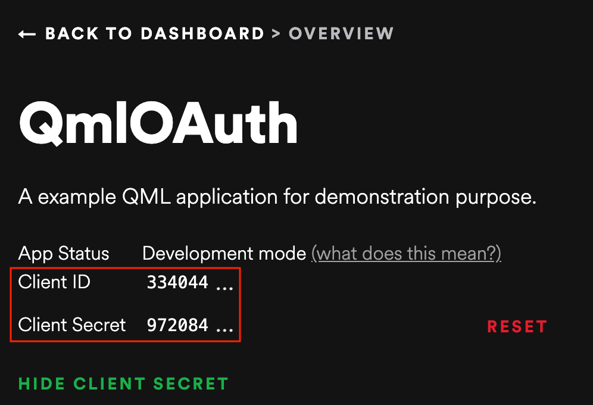
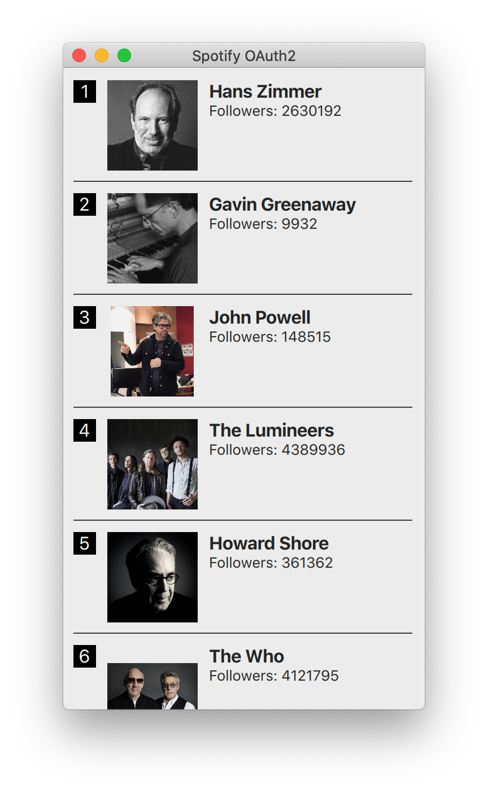

# 使用 OAuth 进行身份验证

OAuth 是一个开放协议，它以简单而标准的方式，为 Web、移动和桌面应用提供安全的授权（authorization）。OAuth 用于对客户端进行身份验证（authentication），使其能使用 Google、Facebook 和 Twitter 等常见 Web 服务。

::: tip
对于自建的 Web 服务，也可以使用标准的 HTTP 身份验证，例如在 get 方法中使用 `XMLHttpRequest` 的用户名和密码（如 `xhr.open(verb, url, true, username, password)`）。
:::

OAuth 目前不是 QML/JS API 的一部分。因此你需要编写一些 C++ 代码，把身份验证导出给 QML/JS。另一个问题是如何安全地存储访问令牌（access token）。

下面这些链接我们认为很有用：

* [http://oauth.net/](http://oauth.net/)
* [http://hueniverse.com/oauth/](http://hueniverse.com/oauth/)
* [https://github.com/pipacs/o2](https://github.com/pipacs/o2)
* [http://www.johanpaul.com/blog/2011/05/oauth2-explained-with-qt-quick/](http://www.johanpaul.com/blog/2011/05/oauth2-explained-with-qt-quick/)

## 集成示例

本节将通过一个例子，演示如何使用 [Spotify API](https://developer.spotify.com/documentation/web-api/) 集成 OAuth。这个例子结合使用了 C++ 类和 QML/JS。想了解更多关于这种集成的内容，请参见第 16 章。

这个应用的目标是获取已认证用户最喜爱的十大艺术家。

### 创建应用

首先，需要在 [Spotify 开发者门户](https://developer.spotify.com/dashboard/applications)上创建一个专用应用。



应用创建完成后，你会收到两个密钥：`client id` 和 `client secret`。



### QML 文件

流程分为两个阶段：

1. 应用连接到 Spotify API，后者转而请求用户对它授权；
2. 如果获得授权，应用会显示用户最喜爱的十大艺术家列表。

#### 为应用授权

先从第一步开始：

<<< @/docs/ch13-networking/src/oauth/main.qml#imports

应用启动时，我们先导入一个自定义库 `Spotify`，它定义了一个 `SpotifyAPI` 组件（稍后会讲到）。然后会实例化这个组件：

<<< @/docs/ch13-networking/src/oauth/main.qml#setup

应用加载完成后，`SpotifyAPI` 组件会向 Spotify 请求授权：

<<< @/docs/ch13-networking/src/oauth/main.qml#on-completed

在获得授权之前，应用中央会显示一个忙碌指示器（busy indicator）。

:::tip
请注意，出于安全原因，绝不能把 API 凭据直接放进 QML 文件！
:::

#### 列出用户喜爱的艺术家

授权获得批准后进行下一步。为了显示艺术家列表，我们将使用模型/视图/委托（Model/View/Delegate）模式：

<<< @/docs/ch13-networking/src/oauth/main.qml#model-view{3,10,13,22,42,51,57,61}

模型 `SpotifyModel` 定义在 `Spotify` 库中。要正常工作，它需要一个 `SpotifyAPI`。

`ListView` 显示一个垂直的艺术家列表。每个艺术家由名称、图像和关注者总数表示。

### SpotifyAPI

现在深入了解一下身份验证流程。我们将聚焦于 `SpotifyAPI` 类，它是在 C++ 一侧定义的 `QML_ELEMENT`。


```cpp
#ifndef SPOTIFYAPI_H
#define SPOTIFYAPI_H

#include <QtCore>
#include <QtNetwork>
#include <QtQml/qqml.h>

#include <QOAuth2AuthorizationCodeFlow>

class SpotifyAPI: public QObject
{
    Q_OBJECT
    QML_ELEMENT

    Q_PROPERTY(bool isAuthenticated READ isAuthenticated WRITE setAuthenticated NOTIFY isAuthenticatedChanged)

public:
    SpotifyAPI(QObject *parent = nullptr);

    void setAuthenticated(bool isAuthenticated) {
        if (m_isAuthenticated != isAuthenticated) {
            m_isAuthenticated = isAuthenticated;
            emit isAuthenticatedChanged();
        }
    }

    bool isAuthenticated() const {
        return m_isAuthenticated;
    }

    QNetworkReply* getTopArtists();

public slots:
    void setCredentials(const QString& clientId, const QString& clientSecret);
    void authorize();

signals:
    void isAuthenticatedChanged();

private:
    QOAuth2AuthorizationCodeFlow m_oauth2;
    bool m_isAuthenticated;
};

#endif // SPOTIFYAPI_H
```

首先导入 `<QOAuth2AuthorizationCodeFlow>` 类。这个类是 `QtNetworkAuth` 模块的一部分，该模块包含 `OAuth` 的多种实现。

```cpp
#include <QOAuth2AuthorizationCodeFlow>
```

我们的类 `SpotifyAPI` 将定义一个 `isAuthenticated` 属性：

```cpp
Q_PROPERTY(bool isAuthenticated READ isAuthenticated WRITE setAuthenticated NOTIFY isAuthenticatedChanged)
```

在 QML 文件中使用的两个公共槽（public slot）：

```cpp
void setCredentials(const QString& clientId, const QString& clientSecret);
void authorize();
```

以及一个表示身份验证流程的私有成员：

```cpp
QOAuth2AuthorizationCodeFlow m_oauth2;
```

在实现一侧，代码如下：

```cpp
#include "spotifyapi.h"

#include <QtGui>
#include <QtCore>
#include <QtNetworkAuth>

SpotifyAPI::SpotifyAPI(QObject *parent): QObject(parent), m_isAuthenticated(false) {
    m_oauth2.setAuthorizationUrl(QUrl("https://accounts.spotify.com/authorize"));
    m_oauth2.setAccessTokenUrl(QUrl("https://accounts.spotify.com/api/token"));
    m_oauth2.setScope("user-top-read");

    m_oauth2.setReplyHandler(new QOAuthHttpServerReplyHandler(8000, this));
    m_oauth2.setModifyParametersFunction([&](QAbstractOAuth::Stage stage, QMultiMap<QString, QVariant> *parameters) {
        if(stage == QAbstractOAuth::Stage::RequestingAuthorization) {
            parameters->insert("duration", "permanent");
        }
    });

    connect(&m_oauth2, &QOAuth2AuthorizationCodeFlow::authorizeWithBrowser, &QDesktopServices::openUrl);
    connect(&m_oauth2, &QOAuth2AuthorizationCodeFlow::statusChanged, [=](QAbstractOAuth::Status status) {
        if (status == QAbstractOAuth::Status::Granted) {
            setAuthenticated(true);
        } else {
            setAuthenticated(false);
        }
    });
}

void SpotifyAPI::setCredentials(const QString& clientId, const QString& clientSecret) {
    m_oauth2.setClientIdentifier(clientId);
    m_oauth2.setClientIdentifierSharedKey(clientSecret);
}

void SpotifyAPI::authorize() {
    m_oauth2.grant();
}

QNetworkReply* SpotifyAPI::getTopArtists() {
    return m_oauth2.get(QUrl("https://api.spotify.com/v1/me/top/artists?limit=10"));
}
```

构造函数的主要任务是配置身份验证流程。首先定义将用作身份验证器的 Spotify API 路由。

```cpp
m_oauth2.setAuthorizationUrl(QUrl("https://accounts.spotify.com/authorize"));
m_oauth2.setAccessTokenUrl(QUrl("https://accounts.spotify.com/api/token"));
```

然后选择要使用的范围（scope，即 Spotify 的授权项）：

```cpp
m_oauth2.setScope("user-top-read");
````

由于 OAuth 是一个双向通信过程，我们实例化一个专用的本地服务器来处理回复：

```cpp
m_oauth2.setReplyHandler(new QOAuthHttpServerReplyHandler(8000, this));
```

最后配置两组信号和槽。

```cpp
connect(&m_oauth2, &QOAuth2AuthorizationCodeFlow::authorizeWithBrowser, &QDesktopServices::openUrl);
connect(&m_oauth2, &QOAuth2AuthorizationCodeFlow::statusChanged, [=](QAbstractOAuth::Status status) { /* ... */ })
```

前者把授权配置为在网页浏览器中进行（通过 `&QDesktopServices::openUrl`），后者则确保授权过程完成时我们会收到通知。

`authorize()` 方法只是调用身份验证流程底层 `grant()` 方法的占位实现。`grant()` 才是触发整个过程的方法。

```cpp
void SpotifyAPI::authorize() {
    m_oauth2.grant();
}
```

最后，`getTopArtists()` 使用 `m_oauth2` 网络访问管理器提供的授权上下文来调用 web api。

```cpp
QNetworkReply* SpotifyAPI::getTopArtists() {
    return m_oauth2.get(QUrl("https://api.spotify.com/v1/me/top/artists?limit=10"));
}
```

### Spotify 模型

这个类是一个 `QML_ELEMENT`，它继承 `QAbstractListModel` 来表示我们的艺术家列表。它依赖 `SpotifyAPI` 从远程端点收集艺术家。

```cpp
#ifndef SPOTIFYMODEL_H
#define SPOTIFYMODEL_H

#include <QtCore>

#include "spotifyapi.h"

QT_FORWARD_DECLARE_CLASS(QNetworkReply)

class SpotifyModel : public QAbstractListModel
{
    Q_OBJECT
    QML_ELEMENT

    Q_PROPERTY(SpotifyAPI* spotifyApi READ spotifyApi WRITE setSpotifyApi NOTIFY spotifyApiChanged)

public:
    SpotifyModel(QObject *parent = nullptr);

    void setSpotifyApi(SpotifyAPI* spotifyApi) {
        if (m_spotifyApi != spotifyApi) {
            m_spotifyApi = spotifyApi;
            emit spotifyApiChanged();
        }
    }

    SpotifyAPI* spotifyApi() const {
        return m_spotifyApi;
    }

    enum {
        NameRole = Qt::UserRole + 1,
        ImageURLRole,
        FollowersCountRole,
        HrefRole,
    };

    QHash<int, QByteArray> roleNames() const override;

    int rowCount(const QModelIndex &parent) const override;
    int columnCount(const QModelIndex &parent) const override;
    QVariant data(const QModelIndex &index, int role) const override;

signals:
    void spotifyApiChanged();
    void error(const QString &errorString);

public slots:
    void update();

private:
    QPointer<SpotifyAPI> m_spotifyApi;
    QList<QJsonObject> m_artists;
};

#endif // SPOTIFYMODEL_H
```

这个类定义了一个 `spotifyApi` 属性：

```cpp
Q_PROPERTY(SpotifyAPI* spotifyApi READ spotifyApi WRITE setSpotifyApi NOTIFY spotifyApiChanged)
```

一组角色（Role）枚举（依照 `QAbstractListModel`）：

```cpp
enum {
    NameRole = Qt::UserRole + 1,    // The artist's name
    ImageURLRole,                   // The artist's image
    FollowersCountRole,             // The artist's followers count
    HrefRole,                       // The link to the artist's page
};
```

一个用于触发刷新艺术家列表的槽：

```cpp
public slots:
    void update();
```

当然还有艺术家列表，以 JSON 对象表示：

```cpp
public slots:
    QList<QJsonObject> m_artists;
```

实现一侧的代码如下：

```cpp
#include "spotifymodel.h"

#include <QtCore>
#include <QtNetwork>

SpotifyModel::SpotifyModel(QObject *parent): QAbstractListModel(parent) {}

QHash<int, QByteArray> SpotifyModel::roleNames() const {
    static const QHash<int, QByteArray> names {
        { NameRole, "name" },
        { ImageURLRole, "imageURL" },
        { FollowersCountRole, "followersCount" },
        { HrefRole, "href" },
    };
    return names;
}

int SpotifyModel::rowCount(const QModelIndex &parent) const {
    Q_UNUSED(parent);
    return m_artists.size();
}

int SpotifyModel::columnCount(const QModelIndex &parent) const {
    Q_UNUSED(parent);
    return m_artists.size() ? 1 : 0;
}

QVariant SpotifyModel::data(const QModelIndex &index, int role) const {
    Q_UNUSED(role);
    if (!index.isValid())
        return QVariant();

    if (role == Qt::DisplayRole || role == NameRole) {
        return m_artists.at(index.row()).value("name").toString();
    }

    if (role == ImageURLRole) {
        const auto artistObject = m_artists.at(index.row());
        const auto imagesValue = artistObject.value("images");

        Q_ASSERT(imagesValue.isArray());
        const auto imagesArray = imagesValue.toArray();
        if (imagesArray.isEmpty())
            return "";

        const auto imageValue = imagesArray.at(0).toObject();
        return imageValue.value("url").toString();
    }

    if (role == FollowersCountRole) {
        const auto artistObject = m_artists.at(index.row());
        const auto followersValue = artistObject.value("followers").toObject();
        return followersValue.value("total").toInt();
    }

    if (role == HrefRole) {
        return m_artists.at(index.row()).value("href").toString();
    }

    return QVariant();
}

void SpotifyModel::update() {
    if (m_spotifyApi == nullptr) {
        emit error("SpotifyModel::error: SpotifyApi is not set.");
        return;
    }

    auto reply = m_spotifyApi->getTopArtists();

    connect(reply, &QNetworkReply::finished, [=]() {
        reply->deleteLater();
        if (reply->error() != QNetworkReply::NoError) {
            emit error(reply->errorString());
            return;
        }

        const auto json = reply->readAll();
        const auto document = QJsonDocument::fromJson(json);

        Q_ASSERT(document.isObject());
        const auto rootObject = document.object();
        const auto artistsValue = rootObject.value("items");

        Q_ASSERT(artistsValue.isArray());
        const auto artistsArray = artistsValue.toArray();
        if (artistsArray.isEmpty())
            return;

        beginResetModel();
        m_artists.clear();
        for (const auto artistValue : qAsConst(artistsArray)) {
            Q_ASSERT(artistValue.isObject());
            m_artists.append(artistValue.toObject());
        }
        endResetModel();
    });
}
```

`update()` 方法调用 `getTopArtists()` 方法并处理其回复：从 JSON 文档中提取各个条目，刷新模型中的艺术家列表。

```cpp
auto reply = m_spotifyApi->getTopArtists();

connect(reply, &QNetworkReply::finished, [=]() {
    reply->deleteLater();
    if (reply->error() != QNetworkReply::NoError) {
        emit error(reply->errorString());
        return;
    }

    const auto json = reply->readAll();
    const auto document = QJsonDocument::fromJson(json);

    Q_ASSERT(document.isObject());
    const auto rootObject = document.object();
    const auto artistsValue = rootObject.value("items");

    Q_ASSERT(artistsValue.isArray());
    const auto artistsArray = artistsValue.toArray();
    if (artistsArray.isEmpty())
        return;

    beginResetModel();
    m_artists.clear();
    for (const auto artistValue : qAsConst(artistsArray)) {
        Q_ASSERT(artistValue.isObject());
        m_artists.append(artistValue.toObject());
    }
    endResetModel();
});
```

`data()` 方法根据所请求的模型角色，提取艺术家相应的属性并以 `QVariant` 返回：

```cpp
    if (role == Qt::DisplayRole || role == NameRole) {
        return m_artists.at(index.row()).value("name").toString();
    }

    if (role == ImageURLRole) {
        const auto artistObject = m_artists.at(index.row());
        const auto imagesValue = artistObject.value("images");

        Q_ASSERT(imagesValue.isArray());
        const auto imagesArray = imagesValue.toArray();
        if (imagesArray.isEmpty())
            return "";

        const auto imageValue = imagesArray.at(0).toObject();
        return imageValue.value("url").toString();
    }

    if (role == FollowersCountRole) {
        const auto artistObject = m_artists.at(index.row());
        const auto followersValue = artistObject.value("followers").toObject();
        return followersValue.value("total").toInt();
    }

    if (role == HrefRole) {
        return m_artists.at(index.row()).value("href").toString();
    }
```




