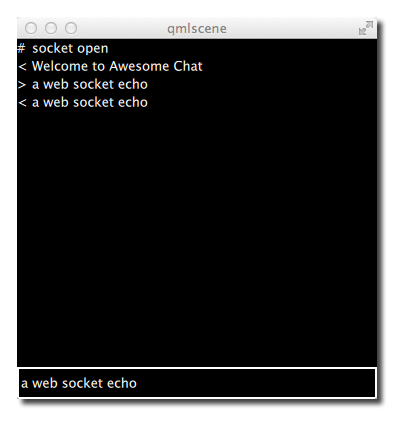

# Web Sockets

WebSockets 模块为 WebSockets 客户端和服务器提供了 WebSockets 协议的实现。它与 Qt CPP 模块相对应。它允许通过全双工（full duplex）通信信道发送字符串和二进制消息。WebSocket 通常通过向服务器发起一个 HTTP 连接来建立，然后由服务器把该连接“升级”为 WebSocket 连接。

在 Qt/QML 中，也可以直接使用 WebSocket 和 WebSocketServer 对象来创建直接的 WebSocket 连接。WebSocket 协议使用 “ws” URL 模式，安全连接则使用 “wss”。

使用 web socket QML 模块前，需要先导入它。

```qml
import QtWebSockets

WebSocket {
    id: socket
}
```

## WS 服务器

你可以用 Qt WebSocket 的 C++ 部分轻松创建自己的 WS 服务器，也可以使用另一种 WS 实现，我觉得这非常有意思。有意思之处在于，它能把 QML 出色的渲染质量与蓬勃发展的 Web 应用服务器连接起来。在这个例子中，我们将使用基于 Node JS 的 web socket 服务器，它用 [ws](https://npmjs.org/package/ws) 模块实现。为此，首先需要安装 [node js](http://nodejs.org/)。然后创建一个 `ws_server` 文件夹，用 node 包管理器（npm）安装 ws 包。

代码将在 NodeJS 中创建一个简单的回显服务器（echo server），把我们的消息回显给 QML 客户端。



```sh
cd ws_server
npm install ws
```

npm 工具会把 ws 包及其依赖下载并安装到你的本地文件夹中。

`server.js` 文件将作为我们的服务器实现。服务器代码会在端口 3000 上创建一个 web socket 服务器并监听传入的连接。有连接进来时，它会发出问候并等待客户端消息。客户端在套接字上发送的每条消息都会被发回客户端。

<<< @/docs/ch13-networking/src/ws/ws_server/server.js#global

你需要习惯 JavaScript 的这种写法和函数回调。

## WS 客户端

在客户端一侧，我们需要一个列表视图来显示消息，以及一个 TextInput 供用户输入新的聊天消息。

示例中会使用一个白色的 `Label` 组件。

<<< @/docs/ch13-networking/src/ws/ws_client/Label.qml#global

我们的聊天视图是一个列表视图，文本被追加到一个列表模型中。每个条目用一行来显示，包含前缀和消息标签。我们使用单元格宽度系数 `cw` 把宽度分成 24 列。

<<< @/docs/ch13-networking/src/ws/ws_client/ChatView.qml#global

聊天输入框只是一个外包彩色边框的简单文本输入框。

<<< @/docs/ch13-networking/src/ws/ws_client/ChatInput.qml#global

当 web socket 收到消息时，会把该消息追加到聊天视图中。状态变化时同样如此。另外，当用户输入聊天消息时，会在客户端一侧把一个副本追加到聊天视图，并把消息发送到服务器。

<<< @/docs/ch13-networking/src/ws/ws_client/ws_client.qml#global

需要先运行服务器，再运行客户端。我们这个简单客户端没有重试连接的机制。


运行服务器：

```sh
cd ws_server
node server.js
```

运行客户端：

```sh
cd ws_client
qml ws_client.qml
```

输入文本并按回车后，你应该会看到类似下面的画面。


