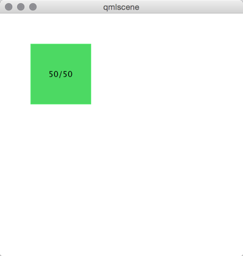

# 本地存储（Local Storage）- SQL

Qt Quick 支持一种在网页浏览器中广为人知的本地存储 API。该 API 可通过 “import QtQuick.LocalStorage 2.0” 使用。

一般而言，它会把内容存储到位于系统特定位置的 SQLite 数据库中，数据库文件以基于给定数据库名称和版本生成的唯一 ID 命名。无法列出或删除已有的数据库。可以通过 `QQmlEngine::offlineStoragePath()` 查找存储位置。

使用该 API 时，先创建一个数据库对象，然后在该数据库上创建事务。每个事务可以包含一条或多条 SQL 查询。当事务中有 SQL 查询失败时，事务将回滚。

例如，要从一个带有文本列的简单 notes 表中读取数据，可以这样使用本地存储：

<<< @/docs/ch14-storage/src/db-snippet/main.qml#global

## 疯狂矩形（Crazy Rectangle）

作为示例，假设我们希望存储场景中一个矩形的位置。



下面是示例的基础部分。它包含一个名为 `crazy` 的矩形，该矩形可以拖动，并以文本形式显示其当前的 `x` 和 `y` 位置。

<<< @/docs/ch14-storage/src/rectangle/main.qml#M1

你可以随意拖动这个矩形。关闭应用并再次启动后，矩形会处于相同的位置。

现在我们希望把矩形的 x/y 位置存储到 SQL 数据库中。为此，我们需要添加 `init`、`read` 和 `store` 这几个数据库函数。这些函数会在组件完成时和组件销毁时被调用。

```qml
import QtQuick
import QtQuick.LocalStorage 2.0

Item {
    // reference to the database object
    property var db

    function initDatabase() {
        // initialize the database object
    }

    function storeData() {
        // stores data to DB
    }

    function readData() {
        // reads and applies data from DB
    }

    Component.onCompleted: {
        initDatabase()
        readData()
    }

    Component.onDestruction: {
        storeData()
    }
}
```

你也可以把数据库代码提取到一个独立的 JS 库中，由它承担全部逻辑。如果逻辑变得更复杂，这是首选的做法。

在数据库初始化函数中，我们创建数据库对象，并确保 SQL 表已经创建。注意，这些数据库函数的输出相当详细，便于你在控制台中跟踪执行过程。

<<< @/docs/ch14-storage/src/rectangle/main.qml#M2

接下来，应用调用 read 函数，从数据库读回已有数据。这里需要区分表中是否已经存在数据。检查的方式是查看 select 子句返回了多少行。

<<< @/docs/ch14-storage/src/rectangle/main.qml#M4

我们假定数据以 JSON 字符串的形式存放在 value 列中。这并不像典型的 SQL 写法，但与 JS 代码配合得很好。因此，我们并不把 x、y 作为表中的属性来存储，而是使用 JSON 的 stringify/parse 方法把它们作为一个完整的 JS 对象存储。最终，我们得到一个带有 x 和 y 属性的有效 JS 对象，可以把它应用到疯狂矩形上。

要存储数据，需要区分 update 和 insert 两种情况。当记录已存在时使用 update；如果不存在名为 “crazy” 的记录，则使用 insert。

<<< @/docs/ch14-storage/src/rectangle/main.qml#M3

与其选取整个记录集，我们也可以像这样使用 SQLite 的 count 函数：`SELECT COUNT(*) from data where name = "crazy"`，它会返回一行，其中包含 select 查询所影响的行数。除此之外，这就是普通的 SQL 代码。作为一项附加功能，我们使用查询中的 `?` 进行 SQL 值绑定。

现在你可以拖动矩形；退出应用时，数据库会保存 x/y 位置，并在下一次运行应用时应用该位置。

