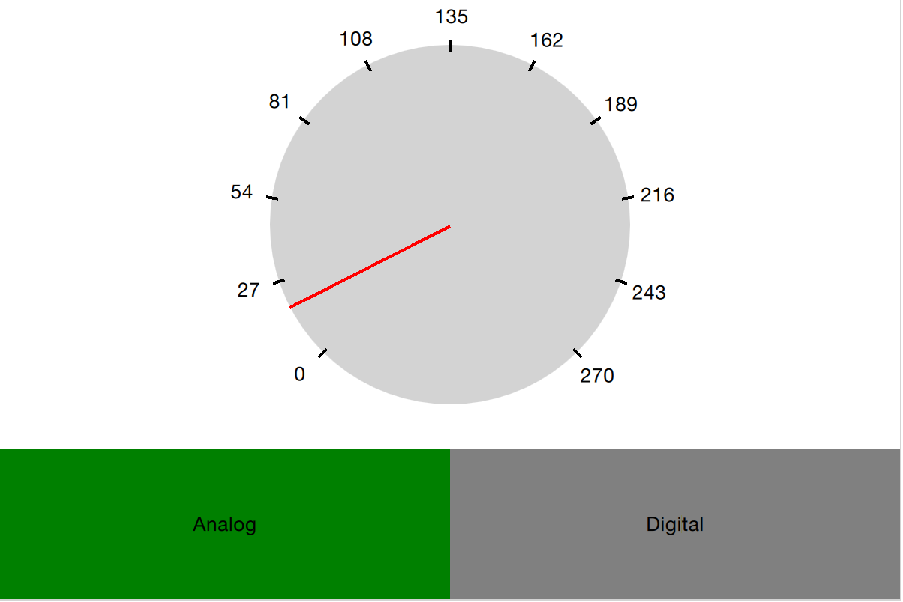
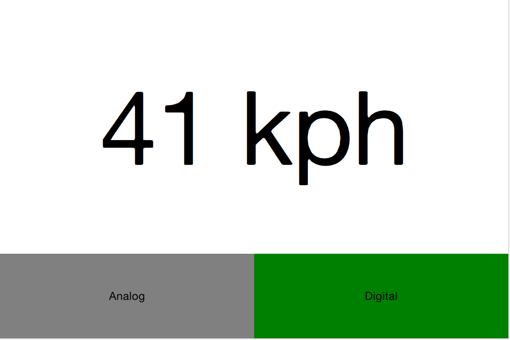
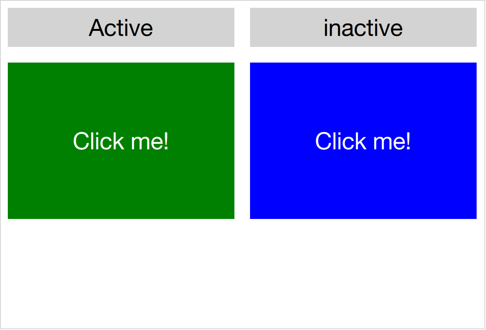

## 动态加载组件

动态加载 QML 各个部分最简单的方式，是使用 `Loader` 元素。它充当被加载项的占位符。要加载的项由 `source` 属性或 `sourceComponent` 属性控制：前者从给定的 URL 加载项，后者则实例化一个 `Component`。

由于加载器充当被加载项的占位符，它的尺寸取决于该项的尺寸，反之亦然。如果 `Loader` 元素具有尺寸——无论是设置了 `width` 和 `height`，还是通过锚点确定——被加载的项就会被赋予加载器的尺寸。如果 `Loader` 没有尺寸，它会按被加载项的尺寸来调整自身大小。

下面描述的例子演示了如何用 `Loader` 元素把两个不同的用户界面部分加载到同一块空间中。其思路是实现一个速度表盘，它既可以是数字式的，也可以是模拟式的，如下图所示。表盘周围的代码不受当前加载的是哪一个项的影响。





应用程序的第一步是声明一个 `Loader` 元素。请注意，这里省略了 `source` 属性。这是因为 `source` 取决于用户界面当前所处的状态。

```qml
Loader {
    id: dialLoader

    anchors.fill: parent
}
```

在 `dialLoader` 父对象的 `states` 属性中，一组 `PropertyChanges` 元素根据 `state` 驱动不同 QML 文件的加载。在本例中 `source` 属性恰好是一个相对文件路径，但它同样可以是完整的 URL，从网络上获取该项。

<<< @/docs/ch15-dynamicqml/src/loader/main.qml#M3

为了让被加载的项真正工作起来，必须把它的 `speed` 属性绑定到根对象的 `speed` 属性。这不能通过直接的属性绑定来完成，因为该项并非始终处于加载状态，而且会随时间改变。因此必须使用 `Binding` 元素。每当 `Loader` 触发 `onLoaded` 信号时，该绑定的 `target` 属性都会被更改。

<<< @/docs/ch15-dynamicqml/src/loader/main.qml#M1

`onLoaded` 信号让执行加载的 QML 能在项被加载后做出反应。与此类似，被加载的 QML 可以依赖 `Component.onCompleted` 信号。该信号实际上对所有组件都可用，与加载方式无关。例如，整个应用程序的根组件可以用它在整个用户界面加载完成后启动自身。

### 间接连接

动态创建 QML 元素时，无法使用静态设置中所用的 `onSignalName` 方式来连接信号。此时必须使用 `Connections` 元素。它可以连接 `target` 元素的任意数量的信号。

设置好 `Connections` 元素的 `target` 属性后，就可以像往常一样，即使用 `onSignalName` 的方式连接信号。不过，通过更改 `target` 属性，可以在不同时刻监视不同的元素。



在上面展示的例子中，向用户呈现了一个由两个可点击区域组成的用户界面。点击任一区域时，都会用动画使其闪烁。左侧区域如下面的代码片段所示。在 `MouseArea` 中会触发 `leftClickedAnimation`，使该区域闪烁。

<<< @/docs/ch15-dynamicqml/src/connections/main.qml#M1

除了两个可点击区域外，还使用了一个 `Connections` 元素。当处于活动状态的区域——即该元素的 `target`——被点击时，它会触发第三个动画。

<<< @/docs/ch15-dynamicqml/src/connections/main.qml#M2

为了确定以哪个 `MouseArea` 为目标，这里定义了两个状态。请注意，不能用 `PropertyChanges` 元素来设置 `target` 属性，因为 `PropertyChanges` 本身已经包含一个 `target` 属性。这里改用 `StateChangeScript`。

<<< @/docs/ch15-dynamicqml/src/connections/main.qml#M3

试用这个例子时值得注意的是：当使用多个信号处理器时，它们都会被调用。但这些处理器的执行顺序是未定义的。

创建 `Connections` 元素而不设置 `target` 属性时，该属性默认为 `parent`。这意味着在设置 `target` 之前，必须把它显式设为 `null`，以免捕获来自 `parent` 的信号。这种行为恰好使我们可以基于 `Connections` 元素创建自定义的信号处理器组件。这样一来，响应信号的代码就可以被封装并重复使用。

在下面的例子中，`Flasher` 组件可以放进任意 `MouseArea` 中。被点击时，它会触发一个动画，使父对象闪烁。在同一个 `MouseArea` 中，也可以执行实际被触发的任务。这样就把标准化的用户反馈（即闪烁）与实际动作分离开来。

<<< @/docs/ch15-dynamicqml/src/connections-parent/Flasher.qml#M1

要使用 `Flasher`，只需在每个 MouseArea 中实例化一个 Flasher，一切就能正常工作。

<<< @/docs/ch15-dynamicqml/src/connections-parent/main.qml#M1

当使用 `Connections` 元素监视多种类型的 `target` 元素的信号时，有时会遇到不同目标可用的信号并不相同的情况。这会导致 `Connections` 元素因为信号缺失而输出运行时错误。为避免这一点，可以把 `ignoreUnknownSignal` 属性设为 `true`。这会忽略所有此类错误。

::: tip
抑制错误信息通常是个糟糕的主意；如果你确实要这样做，请务必在注释中说明原因。
:::

### 间接绑定

正如无法直接连接动态创建的元素的信号一样，不借助桥接元素也无法绑定动态创建的元素的属性。要绑定任意元素（包括动态创建的元素）的属性，需要使用 `Binding` 元素。

`Binding` 元素允许你指定 `target` 元素、要绑定的 `property` 以及绑定到的 `value`。例如，通过使用 `Binding` 元素，就可以绑定动态加载的元素的属性。本章开头的例子演示了这一点，如下所示。

<<< @/docs/ch15-dynamicqml/src/loader/main.qml#M1

由于 `Binding` 的 `target` 元素并不总是已设置，而且也不一定具有某个给定的属性，因此可以用 `Binding` 元素的 `when` 属性来限制绑定处于活动状态的时间。例如，可以把它限制在用户界面的特定模式下。

`Binding` 元素还带有 `delayed` 属性。把该属性设为 `true` 时，绑定在事件队列被清空之前不会传播到 `target`。在高负载情况下，这可以作为一种优化，因为中间值不会被推送到 `target`。

