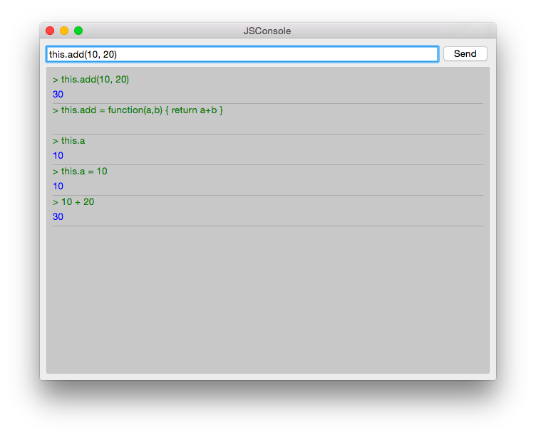

# 创建一个 JS 控制台

作为一个小示例，我们将创建一个 JS 控制台。我们需要一个输入字段，让用户输入 JS 表达式，理想情况下还应该有一个输出结果列表。由于这应该更像一个桌面应用程序，我们使用 Qt Quick Controls 模块。

::: tip
在你的下一个项目中加入 JS 控制台对测试非常有帮助。加上 Quake-Terminal 效果后，它也能给客户留下深刻印象。要善用它，你需要控制 JS 控制台求值的作用域（scope），例如当前可见的屏幕、主数据模型、单例核心对象或以上全部。
:::

我们使用 Qt Creator 创建一个使用 Qt Quick Controls 的 Qt Quick UI 项目。我们将项目命名为 JSConsole。向导完成后，我们已经有了一个基本的应用程序结构，包含一个应用程序窗口和一个用于退出应用程序的菜单。

对于输入，我们使用 TextField 和 Button 来发送输入并进行求值。表达式求值的结果通过 ListView 显示，以 ListModel 作为模型，用两个标签分别显示表达式和求值结果。

我们的应用程序将分为两个文件：
* `JSConsole.qml`：应用程序的主视图
* `jsconsole.js`：负责对用户语句求值的 JavaScript 库

## JSConsole.qml

### 应用程序窗口
<<< @/docs/ch16-javascript/src/JSConsole/JSConsole.qml#application-window

### 表单

<<< @/docs/ch16-javascript/src/JSConsole/JSConsole.qml#form{12,19,40-42,45,50,54-55}

### 调用库

求值函数 `jsCall` 并不亲自执行求值，为了更清晰的分离，求值逻辑已移至一个 JS 模块（`jsconsole.js`）中。

<<< @/docs/ch16-javascript/src/JSConsole/JSConsole.qml#import

<<< @/docs/ch16-javascript/src/JSConsole/JSConsole.qml#js-call

::: tip
出于安全考虑，我们不使用 JS 的 `eval` 函数，因为这会允许用户修改局部作用域。我们使用 Function 构造函数在运行时创建一个 JS 函数，并将我们的作用域作为 this 变量传入。由于函数每次都重新创建，它不会作为闭包来保存自身的作用域，因此我们需要使用 `this.a = 10` 将值存储在函数的这个作用域中。该作用域由脚本设置为 scope 变量。
:::

## jsconsole.js

<<< @/docs/ch16-javascript/src/JSConsole/jsconsole.js#global

调用函数返回的数据是一个包含 result、expression 和 error 属性的 JS 对象：`data: { expression: "", result: "", error: "" }`。我们可以直接在 ListModel 中使用这个 JS 对象，然后从委托（delegate）中访问它，例如 `delegate.model.expression` 给我们输入的表达式。
