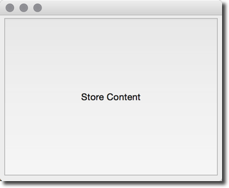

# 一个样板应用程序

理解 Qt 的最好方式是从小示例开始。这个应用程序创建一个简单的 `"Hello World!"` 字符串，并使用 Unicode 字符将其写入文件。

```cpp
#include <QCoreApplication>
#include <QString>
#include <QFile>
#include <QDir>
#include <QTextStream>
#include <QDebug>


int main(int argc, char *argv[])
{
    QCoreApplication app(argc, argv);

    // prepare the message
    QString message("Hello World!");

    // prepare a file in the users home directory named out.txt
    QFile file(QDir::home().absoluteFilePath("out.txt"));
    // try to open the file in write mode
    if(!file.open(QIODevice::WriteOnly)) {
        qWarning() << "Can not open file with write access";
        return -1;
    }
    // as we handle text we need to use proper text codecs
    QTextStream stream(&file);
    // write message to file via the text stream
    stream << message;

    // do not start the eventloop as this would wait for external IO
    // app.exec();

    // no need to close file, closes automatically when scope ends
    return 0;
}
```

该示例演示了文件访问，以及如何使用文本流（text stream）通过文本编解码器把文本写入文件。对于二进制数据，有一个名为 `QDataStream` 的跨平台二进制流，它会处理字节序等细节。我们用到的各个类都在文件顶部通过类名被包含进来。你也可以使用模块名和类名来包含类，例如 `#include <QtCore/QFile>`。怕麻烦的话，也可以用 `#include <QtCore>` 包含某个模块中的所有类。例如，`QtCore` 中包含应用程序常用的、与 UI 无关的类。请查看 [QtCore 类列表](http://doc.qt.io/qt-5/qtcore-module.html) 或 [QtCore 概览](http://doc.qt.io/qt-5/qtcore-index.html)。

你使用 CMake 和 make 来构建应用程序。CMake 读取项目文件 `CMakeLists.txt`，并生成用于构建应用程序的 Makefile。CMake 也支持其他构建系统，例如 ninja。项目文件是平台无关的，并且 CMake 有一些规则，会把平台相关的设置应用到生成的 makefile 中。项目还可以包含用于平台相关规则的平台作用域，这在某些特定情况下是必需的。

下面是由 Qt Creator 生成的一个简单项目文件示例。请注意，Qt 尝试创建一个既兼容 Qt 5 和 Qt 6，也兼容 Android、OS X 等各种平台的文件。

```sh
cmake_minimum_required(VERSION 3.14)

project(projectname VERSION 0.1 LANGUAGES CXX)

set(CMAKE_INCLUDE_CURRENT_DIR ON)

set(CMAKE_AUTOUIC ON)
set(CMAKE_AUTOMOC ON)
set(CMAKE_AUTORCC ON)

set(CMAKE_CXX_STANDARD 11)
set(CMAKE_CXX_STANDARD_REQUIRED ON)

# QtCreator supports the following variables for Android, which are identical to qmake Android variables.
# Check https://doc.qt.io/qt/deployment-android.html for more information.
# They need to be set before the find_package(...) calls below.

#if(ANDROID)
#    set(ANDROID_PACKAGE_SOURCE_DIR "${CMAKE_CURRENT_SOURCE_DIR}/android")
#    if (ANDROID_ABI STREQUAL "armeabi-v7a")
#        set(ANDROID_EXTRA_LIBS
#            ${CMAKE_CURRENT_SOURCE_DIR}/path/to/libcrypto.so
#            ${CMAKE_CURRENT_SOURCE_DIR}/path/to/libssl.so)
#    endif()
#endif()

find_package(QT NAMES Qt6 Qt5 COMPONENTS Core Quick REQUIRED)
find_package(Qt${QT_VERSION_MAJOR} COMPONENTS Core Quick REQUIRED)

set(PROJECT_SOURCES
        main.cpp
        qml.qrc
)

if(${QT_VERSION_MAJOR} GREATER_EQUAL 6)
    qt_add_executable(projectname
        MANUAL_FINALIZATION
        ${PROJECT_SOURCES}
    )
else()
    if(ANDROID)
        add_library(projectname SHARED
            ${PROJECT_SOURCES}
        )
    else()
        add_executable(projectname
          ${PROJECT_SOURCES}
        )
    endif()
endif()

target_compile_definitions(projectname
  PRIVATE $<$<OR:$<CONFIG:Debug>,$<CONFIG:RelWithDebInfo>>:QT_QML_DEBUG>)
target_link_libraries(projectname
  PRIVATE Qt${QT_VERSION_MAJOR}::Core Qt${QT_VERSION_MAJOR}::Quick)

set_target_properties(projectname PROPERTIES
    MACOSX_BUNDLE_GUI_IDENTIFIER my.example.com
    MACOSX_BUNDLE_BUNDLE_VERSION ${PROJECT_VERSION}
    MACOSX_BUNDLE_SHORT_VERSION_STRING ${PROJECT_VERSION_MAJOR}.${PROJECT_VERSION_MINOR}
)

if(QT_VERSION_MAJOR EQUAL 6)
    qt_import_qml_plugins(projectname)
    qt_finalize_executable(projectname)
endif()
```

我们不会深入讲解这个文件。只需记住：Qt 使用 CMake 的 `CMakeLists.txt` 文件生成平台相关的 makefile，然后用它们来构建项目。在构建系统一节中，我们将看看更基础的手写 CMake 文件。

上面的简单代码示例只是写入文本然后退出应用程序。对于命令行工具，这就足够了。对于用户界面，你需要一个事件循环（event loop）来等待用户输入，并以某种方式调度绘制操作。下面还是同一个示例，只是现在用一个按钮来触发写入。

出人意料的是，我们的 `main.cpp` 变小了。我们把代码移入一个独立的类，以便使用 Qt 的信号和槽来处理用户输入，也就是处理按钮点击。信号与槽机制通常需要一个对象实例（稍后你就会看到），但它也可以与 C++ lambda 一起使用。

```cpp
#include <QtCore>
#include <QtGui>
#include <QtWidgets>
#include "mainwindow.h"


int main(int argc, char** argv)
{
    QApplication app(argc, argv);

    MainWindow win;
    win.resize(320, 240);
    win.setVisible(true);

    return app.exec();
}
```

在 `main` 函数中，我们创建应用程序对象和一个窗口，然后用 `exec()` 启动事件循环。此后，应用程序就停留在事件循环中，等待用户输入。

```cpp
int main(int argc, char** argv)
{
    QApplication app(argc, argv); // init application

    // create the ui

    return app.exec(); // execute event loop
}
```

使用 Qt，你可以用 QML 和 Widgets 构建用户界面。本书以 QML 为重点，但在本章中，我们将看看 Widgets。这样我们就可以只用 C++ 来创建程序。



主窗口本身是一个窗口部件（widget）。由于它没有任何父对象，因此成为一个顶层窗口。这源于 Qt 把用户界面视为一棵 UI 元素树的方式。在这种情况下，主窗口是根元素，因而成为窗口；而作为主窗口子对象的按钮，则成为窗口内的一个窗口部件。

```cpp
#ifndef MAINWINDOW_H
#define MAINWINDOW_H

#include <QtWidgets>

class MainWindow : public QMainWindow
{
public:
    MainWindow(QWidget* parent=0);
    ~MainWindow();
public slots:
    void storeContent();
private:
    QPushButton *m_button;
};

#endif // MAINWINDOW_H
```

此外，我们在头文件的一个自定义小节中定义了名为 `storeContent()` 的公有槽。槽可以是公有、受保护或私有的，并且可以像其他类方法一样被调用。你可能还会遇到 `signals` 小节，其中列出一组信号签名。这些方法不应被调用，也不得被实现。信号和槽都由 Qt 元信息系统处理，可以在运行时被内省并动态调用。

`storeContent()` 槽的用途是在按钮被点击时被调用。让我们来实现这一点！

```cpp
#include "mainwindow.h"

MainWindow::MainWindow(QWidget *parent)
    : QMainWindow(parent)
{
    m_button = new QPushButton("Store Content", this);

    setCentralWidget(m_button);
    connect(m_button, &QPushButton::clicked, this, &MainWindow::storeContent);
}

MainWindow::~MainWindow()
{

}

void MainWindow::storeContent()
{
    qDebug() << "... store content";
    QString message("Hello World!");
    QFile file(QDir::home().absoluteFilePath("out.txt"));
    if(!file.open(QIODevice::WriteOnly)) {
        qWarning() << "Can not open file with write access";
        return;
    }
    QTextStream stream(&file);
    stream << message;
}

```

在主窗口中，我们首先创建按钮，然后用 connect 方法将信号 `clicked()` 与槽 `storeContent()` 关联起来。每当信号 `clicked` 被发出，槽 `storeContent()` 就会被调用。现在，这两个对象通过信号和槽相互通信，尽管它们彼此并不知道对方的存在。这称为松耦合（loose coupling），它因使用大多数 Qt 类都派生自的 `QObject` 基类而成为可能。
