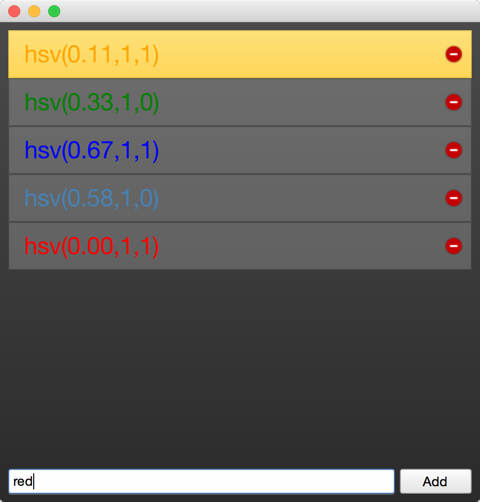

# C++ 中的模型

集成 C++ 与 QML 最常见的方式之一是通过*模型*。*模型*向*视图*提供数据，例如 `ListViews`、`GridView`、`PathViews` 以及其他视图；这些视图接受一个模型，并为模型中的每个条目创建一个委托（delegate）实例。视图足够聪明，只会创建可见的或处于缓存范围内的实例。这使得模型可以拥有数以万计的条目，同时用户界面依然非常流畅。委托就像一个模板，用模型条目的数据进行渲染。总而言之：视图使用委托作为模板，渲染来自模型的条目。模型是视图的数据提供者。

当你不想使用 C++ 时，也可以用纯 QML 定义模型。你有多种方式为视图提供模型。对于来自 C++ 的数据或大量数据的处理，C++ 模型比这种纯 QML 方式更合适。但如果你只需要少量条目，这些 QML 模型就很适合。

```qml
ListView {
    // using a integer as model
    model: 5
    delegate: Text { text: 'index: ' + index }
}

ListView {
    // using a JS array as model
    model: ['A', 'B', 'C', 'D', 'E']
    delegate: Text { 'Char['+ index +']: ' + modelData }
}

ListView {
    // using a dynamic QML ListModel as model
    model: ListModel {
        ListElement { char: 'A' }
        ListElement { char: 'B' }
        ListElement { char: 'C' }
        ListElement { char: 'D' }
        ListElement { char: 'E' }
    }
    delegate: Text { 'Char['+ index +']: ' + model.char }
}
```

QML 视图知道如何处理这些不同类型的模型。对于来自 C++ 世界的模型，视图期望遵循一个特定的协议。该协议定义在 `QAbstractItemModel` 的 API 中，同时配有描述动态行为的文档。这套 API 是为在桌面窗口部件世界中驱动视图而开发的，其灵活性足以作为树、多列表格以及列表的基础。在 QML 中，我们通常使用该 API 的列表变体 `QAbstractListModel`，或者（对于 `TableView` 元素）使用该 API 的表格变体 `QAbstractTableModel`。该 API 包含一些必须实现的函数，以及一些扩展模型能力的可选函数。可选部分主要处理更改、添加或删除数据的动态用例。

## 一个简单的模型

典型的 QML C++ 模型派生自 `QAbstractListModel`，并至少实现 `data` 和 `rowCount` 函数。在下面的示例中，我们将使用 `QColor` 类提供的一系列 SVG 颜色名称，并用我们的模型显示它们。数据存储在 `QList<QString>` 数据容器中。

我们的 `DataEntryModel` 派生自 `QAbstractListModel`，并实现了必需的函数。我们可以忽略 `rowCount` 中的 parent，因为它只在树模型中使用。`QModelIndex` 类为视图想要获取数据的单元格提供行和列信息。视图基于行/列和角色（role）从模型拉取信息。`QAbstractListModel` 定义在 `QtCore` 中，而 `QColor` 定义在 `QtGui` 中。这就是我们额外依赖 `QtGui` 的原因。对于 QML 应用程序，依赖 `QtGui` 是可以的，但通常不应依赖 `QtWidgets`。

```cpp
#ifndef DATAENTRYMODEL_H
#define DATAENTRYMODEL_H

#include <QtCore>
#include <QtGui>

class DataEntryModel : public QAbstractListModel
{
    Q_OBJECT
public:
    explicit DataEntryModel(QObject *parent = 0);
    ~DataEntryModel();

public: // QAbstractItemModel interface
    virtual int rowCount(const QModelIndex &parent) const;
    virtual QVariant data(const QModelIndex &index, int role) const;
private:
    QList<QString> m_data;
};

#endif // DATAENTRYMODEL_H
```

在实现方面，最复杂的部分是 data 函数。我们首先需要进行范围检查，确保提供给我们的索引有效。然后检查是否支持显示角色（display role）。模型中的每个条目可以有多个显示角色，用来定义所含数据的各个方面。`Qt::DisplayRole` 是视图会请求的默认文本角色。Qt 中定义了一小组可供使用的默认角色，但通常模型会为清晰起见定义自己的角色。在本例中，目前所有不包含显示角色的调用都会被忽略，并返回默认值 `QVariant()`。

```cpp
#include "dataentrymodel.h"

DataEntryModel::DataEntryModel(QObject *parent)
    : QAbstractListModel(parent)
{
    // initialize our data (QList<QString>) with a list of color names
    m_data = QColor::colorNames();
}

DataEntryModel::~DataEntryModel()
{
}

int DataEntryModel::rowCount(const QModelIndex &parent) const
{
    Q_UNUSED(parent);
    // return our data count
    return m_data.count();
}

QVariant DataEntryModel::data(const QModelIndex &index, int role) const
{
    // the index returns the requested row and column information.
    // we ignore the column and only use the row information
    int row = index.row();

    // boundary check for the row
    if(row < 0 || row >= m_data.count()) {
        return QVariant();
    }

    // A model can return data for different roles.
    // The default role is the display role.
    // it can be accesses in QML with "model.display"
    switch(role) {
        case Qt::DisplayRole:
            // Return the color name for the particular row
            // Qt automatically converts it to the QVariant type
            return m_data.value(row);
    }

    // The view asked for other data, just return an empty QVariant
    return QVariant();
}
```

下一步是使用 `qmlRegisterType` 调用把模型注册到 QML。这在 `main.cpp` 中、加载 QML 文件之前完成。

```cpp
#include <QtGui>
#include <QtQml>

#include "dataentrymodel.h"

int main(int argc, char *argv[])
{
    QGuiApplication app(argc, argv);

    // register the type DataEntryModel
    // under the url "org.example" in version 1.0
    // under the name "DataEntryModel"
    qmlRegisterType<DataEntryModel>("org.example", 1, 0, "DataEntryModel");

    QQmlApplicationEngine engine;
    engine.load(QUrl(QStringLiteral("qrc:/main.qml")));

    return app.exec();
}
```

现在你可以使用 QML 导入语句 `import org.example 1.0` 来访问 `DataEntryModel`，并像其他 QML 项一样使用它：`DataEntryModel {}`。

在本例中，我们用它来显示一个简单的颜色条目列表。

```qml
import org.example 1.0

ListView {
    id: view
    anchors.fill: parent
    model: DataEntryModel {}
    delegate: ListDelegate {
        // use the defined model role "display"
        text: model.display
    }
    highlight: ListHighlight { }
}
```

`ListDelegate` 是一个用于显示文本的自定义类型。`ListHighlight` 只是一个矩形。这些代码被抽离出去，以保持示例紧凑。

视图现在可以使用 C++ 模型和模型的 display 属性来显示字符串列表。它仍然非常简单，但已经可以在 QML 中使用。通常数据由模型外部提供，模型充当通往视图的接口。

::: tip
要暴露数据表而不是列表，应使用 `QAbstractTableModel`。与实现 `QAbstractListModel` 相比，唯一的区别是你还必须提供 `columnCount` 方法。
:::

## 更复杂的数据

在现实中，模型数据往往复杂得多。因此需要定义自定义角色，让视图能够通过属性查询其他数据。例如，模型不仅可以把颜色作为十六进制字符串提供，还可以在 QML 中把 HSV 颜色模型的色相、饱和度和亮度分别作为 “model.hue”、“model.saturation” 和 “model.brightness” 提供。

```cpp
#ifndef ROLEENTRYMODEL_H
#define ROLEENTRYMODEL_H

#include <QtCore>
#include <QtGui>

class RoleEntryModel : public QAbstractListModel
{
    Q_OBJECT
public:
    // Define the role names to be used
    enum RoleNames {
        NameRole = Qt::UserRole,
        HueRole = Qt::UserRole+2,
        SaturationRole = Qt::UserRole+3,
        BrightnessRole = Qt::UserRole+4
    };

    explicit RoleEntryModel(QObject *parent = 0);
    ~RoleEntryModel();

    // QAbstractItemModel interface
public:
    virtual int rowCount(const QModelIndex &parent) const override;
    virtual QVariant data(const QModelIndex &index, int role) const override;
protected:
    // return the roles mapping to be used by QML
    virtual QHash<int, QByteArray> roleNames() const override;
private:
    QList<QColor> m_data;
    QHash<int, QByteArray> m_roleNames;
};

#endif // ROLEENTRYMODEL_H
```

在头文件中，我们添加了供 QML 使用的角色映射。现在当 QML 尝试从模型访问属性（例如 “model.name”）时，列表视图会查找 “name” 对应的映射，并使用 `NameRole` 向模型请求数据。用户定义的角色应从 `Qt::UserRole` 开始，并且在每个模型中必须唯一。

```cpp
#include "roleentrymodel.h"

RoleEntryModel::RoleEntryModel(QObject *parent)
    : QAbstractListModel(parent)
{
    // Set names to the role name hash container (QHash<int, QByteArray>)
    // model.name, model.hue, model.saturation, model.brightness
    m_roleNames[NameRole] = "name";
    m_roleNames[HueRole] = "hue";
    m_roleNames[SaturationRole] = "saturation";
    m_roleNames[BrightnessRole] = "brightness";

    // Append the color names as QColor to the data list (QList<QColor>)
    for(const QString& name : QColor::colorNames()) {
        m_data.append(QColor(name));
    }

}

RoleEntryModel::~RoleEntryModel()
{
}

int RoleEntryModel::rowCount(const QModelIndex &parent) const
{
    Q_UNUSED(parent);
    return m_data.count();
}

QVariant RoleEntryModel::data(const QModelIndex &index, int role) const
{
    int row = index.row();
    if(row < 0 || row >= m_data.count()) {
        return QVariant();
    }
    const QColor& color = m_data.at(row);
    qDebug() << row << role << color;
    switch(role) {
    case NameRole:
        // return the color name as hex string (model.name)
        return color.name();
    case HueRole:
        // return the hue of the color (model.hue)
        return color.hueF();
    case SaturationRole:
        // return the saturation of the color (model.saturation)
        return color.saturationF();
    case BrightnessRole:
        // return the brightness of the color (model.brightness)
        return color.lightnessF();
    }
    return QVariant();
}

QHash<int, QByteArray> RoleEntryModel::roleNames() const
{
    return m_roleNames;
}
```

实现现在只在两处发生了变化。首先是初始化。我们现在用 QColor 数据类型初始化数据列表。此外，我们定义了供 QML 访问的角色名称映射。这个映射稍后在 `::roleNames` 函数中返回。

第二处变化在 `::data` 函数中。我们扩展 switch 以覆盖其他角色（例如色相、饱和度、亮度）。无法从一个颜色返回 SVG 名称，因为颜色可以取任意值，而 SVG 名称是有限的。所以我们跳过这一点。若要存储名称，就需要创建一个结构 `struct { QColor, QString }`，以便识别具名颜色。

注册类型之后，我们就可以在用户界面中使用该模型及其条目。

```qml
ListView {
    id: view
    anchors.fill: parent
    model: RoleEntryModel {}
    focus: true
    delegate: ListDelegate {
        text: 'hsv(' +
              Number(model.hue).toFixed(2) + ',' +
              Number(model.saturation).toFixed() + ',' +
              Number(model.brightness).toFixed() + ')'
        color: model.name
    }
    highlight: ListHighlight { }
}
```

我们把返回类型转换为 JS 数字类型，以便用定点表示法格式化数字。即使不调用 Number，代码也能工作（例如直接写 `model.saturation.toFixed(2)`）。选择哪种格式，取决于你对传入数据的信任程度。

## 动态数据

动态数据涵盖向模型插入、移除和清空数据这几个方面。当条目被移除或插入时，`QAbstractListModel` 期望一种特定的行为。这种行为体现为需要在操作前后调用的信号。例如，要向模型插入一行，你需要先发出信号 `beginInsertRows`，然后操作数据，最后发出 `endInsertRows`。

我们将把以下函数添加到头文件中。这些函数使用 `Q_INVOKABLE` 声明，以便能够从 QML 调用它们。另一种方式是把它们声明为公有槽。

```cpp
// inserts a color at the index (0 at begining, count-1 at end)
Q_INVOKABLE void insert(int index, const QString& colorValue);
// uses insert to insert a color at the end
Q_INVOKABLE void append(const QString& colorValue);
// removes a color from the index
Q_INVOKABLE void remove(int index);
// clear the whole model (e.g. reset)
Q_INVOKABLE void clear();
```

此外，我们定义一个 `count` 属性来获取模型的大小，以及一个 `get` 方法来获取给定索引处的颜色。当你想从 QML 遍历模型内容时，这很有用。

```cpp
// gives the size of the model
Q_PROPERTY(int count READ count NOTIFY countChanged)
// gets a color at the index
Q_INVOKABLE QColor get(int index);
```

insert 的实现首先检查边界以及给定的值是否有效。只有这样，我们才开始插入数据。

```cpp
void DynamicEntryModel::insert(int index, const QString &colorValue)
{
    if(index < 0 || index > m_data.count()) {
        return;
    }
    QColor color(colorValue);
    if(!color.isValid()) {
        return;
    }
    // view protocol (begin => manipulate => end]
    emit beginInsertRows(QModelIndex(), index, index);
    m_data.insert(index, color);
    emit endInsertRows();
    // update our count property
    emit countChanged(m_data.count());
}
```

append 非常简单。我们以模型的大小复用 insert 函数。

```cpp
void DynamicEntryModel::append(const QString &colorValue)
{
    insert(count(), colorValue);
}
```

remove 与 insert 类似，但它按照移除操作的协议进行调用。

```cpp
void DynamicEntryModel::remove(int index)
{
    if(index < 0 || index >= m_data.count()) {
        return;
    }
    emit beginRemoveRows(QModelIndex(), index, index);
    m_data.removeAt(index);
    emit endRemoveRows();
    // do not forget to update our count property
    emit countChanged(m_data.count());
}
```

辅助函数 `count` 微不足道，它只是返回数据数量。`get` 函数也相当简单。

```cpp
QColor DynamicEntryModel::get(int index)
{
    if(index < 0 || index >= m_data.count()) {
        return QColor();
    }
    return m_data.at(index);
}
```

你需要注意，只返回 QML 能理解的值。如果它不是基本的 QML 类型或 QML 已知的类型，你需要先用 `qmlRegisterType` 或 `qmlRegisterUncreatableType` 注册该类型。如果不希望用户能够在 QML 中实例化自己的对象，就使用 `qmlRegisterUncreatableType`。

现在你可以在 QML 中使用该模型，并向模型插入、追加、移除条目。下面是一个小示例：用户可以输入颜色名称或颜色十六进制值，该颜色随后被追加到模型并显示在列表视图中。委托上的红色圆圈允许用户从模型中移除该条目。条目被移除后，列表视图会收到模型的通知并更新其内容。



下面是 QML 代码。你也可以在本章的资源文件中找到完整源代码。示例使用 `QtQuick.Controls` 和 `QtQuick.Layout` 模块使代码更紧凑。控件模块在 Qt Quick 中提供了一组与桌面相关的 UI 元素，而布局模块提供了一些非常有用的布局管理器。

<<< @/docs/ch17-qtcpp/src/modelview/main.qml#global

模型视图编程是 Qt 中较为复杂的开发任务之一。它是为数不多的、需要普通应用程序开发者实现接口的情形之一。其他所有类你只需正常使用。模型的构思应当始终从 QML 端开始。你应该设想用户会如何在 QML 中使用你的模型。为此，通常最好先用 `ListModel` 创建一个原型，看看它在 QML 中怎样工作得最好。在定义 QML API 时也是如此。把数据从 C++ 提供给 QML 不仅是一道技术边界，也是从命令式到声明式编程风格的编程范式转变。所以，做好经历一些挫折和顿悟时刻的准备吧 :-)。

