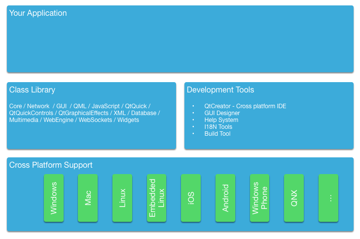

# Qt 与 C++

Qt 是一个 C++ 工具包，并带有针对 QML 和 JavaScript 的扩展。Qt 存在许多语言绑定，但 Qt 本身是用 C++ 开发的。C++ 的精神贯穿于这些类之中。在本节中，我们将从 C++ 的视角来审视 Qt，以便更好地理解如何使用 C++ 开发的原生插件扩展 QML。通过 C++，可以扩展并控制提供给 QML 的执行环境。

与 Qt 一样，本章要求读者具备一些 C++ 基础知识。Qt 并不依赖 C++ 的高级特性，而且我通常认为 Qt 风格的 C++ 可读性很好，所以如果你觉得自己的 C++ 知识不够扎实，也不必担心。

## Qt C++

从 C++ 的方向走近 Qt，你会发现 Qt 通过让内省（introspection）数据可用，为 C++ 增添了许多现代语言特性。这要归功于 `QObject` 基类的使用。内省数据也就是元数据（metadata），它在运行时保存类的信息，而普通 C++ 并不这样做。这使得我们可以动态地探测对象，获取诸如属性和可用方法之类的详细信息。

Qt 利用这些元信息，通过信号（signal）与槽（slot）实现了一种绑定非常松散的回调概念。每个信号都可以连接到任意数量的槽，甚至可以连接到其他信号。当对象实例发出信号时，与之连接的槽就会被调用。由于发出信号的对象无需了解拥有槽的对象的任何信息，反之亦然，这一机制被用来创建依赖极少、可高度复用的组件。

## Qt for Python

内省特性还被用于创建动态语言绑定，从而可以把 C++ 对象实例暴露给 QML，并使 C++ 函数可从 JavaScript 调用。Qt C++ 还存在其他语言绑定；除了标准的 JavaScript 绑定之外，官方的绑定是名为 [PySide6](https://www.qt.io/qt-for-python) 的 Python 绑定。

## 跨平台

除了这一核心概念之外，Qt 还使开发者能够用 C++ 开发跨平台应用程序。Qt C++ 在不同的操作系统之上提供了平台抽象，让开发者专注于手头的任务，而不必操心在不同操作系统上如何打开文件这类细节。这意味着你可以把同一份源代码重新编译到 Windows、OS X 和 Linux 上，由 Qt 来处理不同操作系统在处理某些事情时的不同做法。最终得到的是以原生方式构建、具有目标平台外观和体验的应用程序。由于移动平台已成为新的桌面，较新的 Qt 版本还可以用同一份源代码面向多种移动平台，例如 iOS、Android、Jolla、BlackBerry、Ubuntu Phone、Tizen。

谈到复用，不仅可以复用源代码，开发者的技能同样可以复用。一个掌握 Qt 的团队能够触及的平台，远多于只专注于单一平台专用技术的团队；而且由于 Qt 如此灵活，团队可以用同一套技术创建不同的系统组件。

对于所有平台，Qt 都提供了一组基本类型，例如完全支持 Unicode 的字符串、列表、向量、缓冲区。它还对目标平台的主循环提供了统一的抽象，以及跨平台的线程和网络支持。总体理念是：对于应用程序开发者而言，Qt 自带所需的全部功能。对于特定领域的任务（例如与你的原生库对接），Qt 也提供了若干辅助类来简化这项工作。
