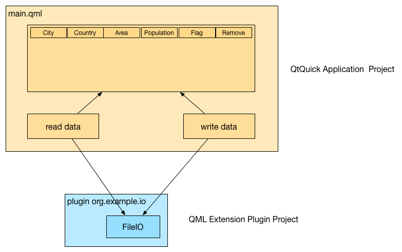
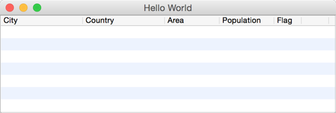
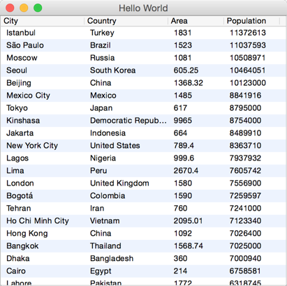
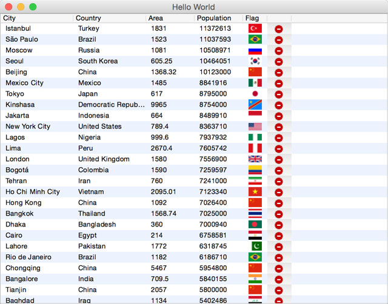

# 使用 FileIO

现在我们可以用新创建的文件来访问一些数据了。在本例中，我们将使用一些 JSON 格式的城市数据，并把它们显示在表格中。我们把它构建为两个项目：一个是扩展插件（名为 `fileio`），为我们提供从文件读写文本的方式；另一个则在表格中显示数据（`CityUI`）。`CityUI` 使用 `fileio` 扩展来读写文件。



JSON 数据不过是格式特殊的文本，这种格式使它可以转换为有效的 JavaScript 对象/数组，也可以再转回文本。我们用 `FileIO` 读取 JSON 格式的数据，并使用内置的 JavaScript 函数 `JSON.parse()` 把它转换为 JavaScript 对象。这些数据随后被用作表格视图的模型。下面展示的读取文档与写入文档函数实现了这一点。

<<< @/docs/ch18-extensions/src/CityUI/main.qml#readwrite

本例使用的 JSON 数据在 `cities.json` 文件中。
它包含一个城市数据条目列表，每个条目包含关于该城市的一些有用数据，如下所示。

```json
[
    {
        "area": "1928",
        "city": "Shanghai",
        "country": "China",
        "flag": "22px-Flag_of_the_People's_Republic_of_China.svg.png",
        "population": "13831900"
    },
    ...
]
```

## 应用程序窗口

我们使用 Qt Creator 的 `QtQuick Application` 向导创建一个基于 Qt Quick Controls 2 的应用程序。我们不会使用新的 QML 表单（forms），因为这在书中难以解释，尽管基于 *ui.qml* 文件的新表单方式比以前好用得多。所以你现在可以先移除/删除表单文件。

基本结构是一个 `ApplicationWindow`，它可以包含工具栏、菜单栏和状态栏。我们只使用菜单栏，为打开和保存文档创建一些标准菜单项。基本结构只显示一个空窗口。

```qml
import QtQuick 2.5
import QtQuick.Controls 1.3
import QtQuick.Window 2.2
import QtQuick.Dialogs 1.2

ApplicationWindow {
    id: root
    title: qsTr("City UI")
    width: 640
    height: 480
    visible: true
}
```

## 使用 Action

为了更好地使用/复用我们的命令，我们使用 QML 的 `Action` 类型。这样稍后也可以把同样的动作用于可能的工具栏。打开、保存和退出这几个动作都很标准。打开和保存动作目前还不包含任何逻辑，这一步稍后完成。菜单栏由一个文件菜单和这三个动作项组成。此外，我们已经先准备好了一个文件对话框，稍后它将让我们选择城市文档。对话框在声明时并不可见，你需要调用 `open()` 方法来显示它。

<<< @/docs/ch18-extensions/src/CityUI/main.qml#actions

## 格式化表格

城市数据的内容要显示在表格中。为此我们使用 `TableView` 控件，并声明 4 列：城市、国家、面积、人口。每一列都是标准的 `TableViewColumn`。稍后我们将添加国旗列和删除操作列，这将需要自定义的列委托。

```qml
TableView {
    id: view
    anchors.fill: parent
    TableViewColumn {
        role: 'city'
        title: "City"
        width: 120
    }
    TableViewColumn {
        role: 'country'
        title: "Country"
        width: 120
    }
    TableViewColumn {
        role: 'area'
        title: "Area"
        width: 80
    }
    TableViewColumn {
        role: 'population'
        title: "Population"
        width: 80
    }
}
```

现在应用程序应该会显示一个带文件菜单的菜单栏，以及一个带 4 个表头的空表格。下一步是用我们的 *FileIO* 扩展向表格填充有用的数据。




`cities.json` 文档是一个城市条目数组。下面是一个例子。

```json
[
    {
        "area": "1928",
        "city": "Shanghai",
        "country": "China",
        "flag": "22px-Flag_of_the_People's_Republic_of_China.svg.png",
        "population": "13831900"
    },
    ...
]
```

我们的任务是让用户能够选择文件、读取它、转换它，并将其设置到表格视图上。

## 读取数据

为此，我们让打开动作打开文件对话框。当用户选定一个文件后，文件对话框上的 `onAccepted` 方法会被调用。在那里我们调用 `readDocument()` 函数。`readDocument()` 函数把来自文件对话框的 URL 设置到 `FileIO` 对象上，并调用 `read()` 方法。然后用 `JSON.parse()` 方法解析从 `FileIO` 加载的文本，得到的对象直接作为模型设置到表格视图上。多么方便！

```qml
Action {
    id: open
    ...
    onTriggered: {
        openDialog.open()
    }
}

...

FileDialog {
    id: openDialog
    onAccepted: {
        root.readDocument()
    }
}

function readDocument() {
    io.source = openDialog.fileUrl
    io.read()
    view.model = JSON.parse(io.text)
}


FileIO {
    id: io
}
```

## 写入数据

要保存文档，我们把“保存”动作连接到 `saveDocument()` 函数。save document 函数从视图获取模型（一个 JavaScript 对象），并用 `JSON.stringify()` 函数把它转换成字符串。得到的字符串被设置到 `FileIO` 对象的 text 属性上，然后我们调用 `write()` 把数据保存到磁盘。`stringify` 函数的“null”和“4”参数会让生成的 JSON 数据使用 4 个空格缩进。这只是为了让保存的文档更易读。

```qml
Action {
    id: save
    ...
    onTriggered: {
        saveDocument()
    }
}

function saveDocument() {
    var data = view.model
    io.text = JSON.stringify(data, null, 4)
    io.write()
}

FileIO {
    id: io
}
```

这基本上就是一个能够读取、写入和显示 JSON 文档的应用程序了。想想过去编写 XML 读写器所花费的全部时间吧。有了 JSON，你所需要的只是一种读写文本文件或收发文本缓冲区的方式。




## 收尾工作

应用程序还没有完全就绪。我们还想显示国旗，并允许用户从模型中删除城市来修改文档。

在这个示例中，国旗文件保存在相对于 `main.qml` 文档的 *flags* 文件夹中。为了能够显示它们，表格列需要定义一个用于渲染国旗图像的自定义委托。

```qml
TableViewColumn {
    delegate: Item {
        Image {
            anchors.centerIn: parent
            source: 'flags/' + styleData.value
        }
    }
    role: 'flag'
    title: "Flag"
    width: 40
}
```

显示国旗所需的全部工作就是这些。它把 JavaScript 模型中的 flag 属性以 `styleData.value` 的形式暴露给委托。然后委托调整图像路径，加上前缀 `'flags/'`，并将其作为 `Image` 元素显示。

对于删除操作，我们使用类似的技术来显示一个删除按钮。

```qml
TableViewColumn {
    delegate: Button {
        iconSource: "remove.png"
        onClicked: {
            var data = view.model
            data.splice(styleData.row, 1)
            view.model = data
        }
    }
    width: 40
}
```

在数据删除操作中，我们先拿到视图的模型，然后用 JavaScript 的 `splice` 函数移除一个条目。之所以可以使用这个方法，是因为模型属于 JavaScript 数组类型。splice 方法通过移除现有元素和/或添加新元素来改变数组的内容。

遗憾的是，JavaScript 数组不像 `QAbstractItemModel` 这样的 Qt 模型那样聪明，后者会把行变化或数据变化通知视图。目前视图不会显示任何更新后的数据，因为它从未收到任何变化通知。只有当我们把数据重新设置回视图时，视图才意识到有新数据并刷新视图内容。再次使用 `view.model = data` 设置模型，就是让视图知道数据发生了变化的一种方式。



