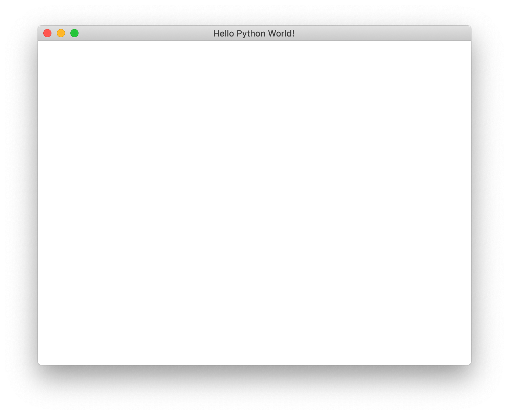
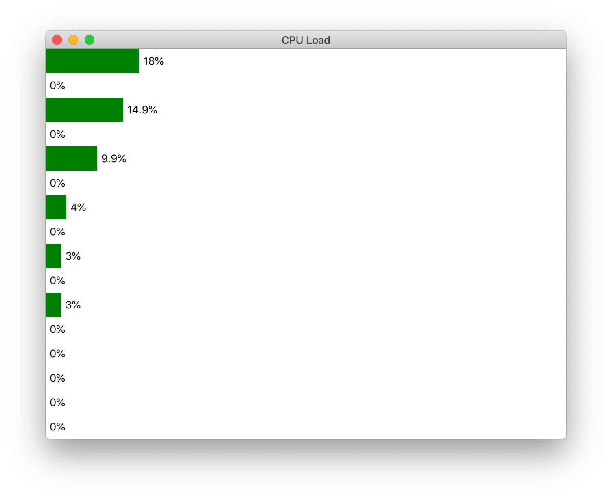

# 构建应用程序

本章将介绍如何把 Python 和 QML 结合起来。结合这两个世界最自然的方式与结合 C++ 和 QML 一样，即用 Python 实现逻辑、用 QML 实现界面呈现。

为此，我们需要了解如何把 QML 和 Python 组合进同一个程序，然后了解如何在两个世界之间实现接口。在下面的各小节中，我们将看到具体的做法。我们会从简单示例开始，逐步进阶到一个通过 Qt 项模型（item model）把 Python 模块的能力暴露给 QML 的例子。

## 从 Python 运行 QML

第一步是创建一个 Python 程序，用来承载下面这个 *Hello World* QML 程序。

<<< @/docs/ch19-python/src/basic/main.qml#global

为此，我们需要 `QtGui` 模块中 `QGuiApplication` 提供的 Qt 事件循环（mainloop）。我们还需要 `QtQml` 模块中的 `QQmlApplicationEngine`。为了把源文件的引用传递给 QML 应用引擎，我们还需要 `QtCore` 模块中的 `QUrl` 类。

在下面的代码中，我们模拟了 Qt Creator 为 QML 项目生成的 C++ 样板代码（boilerplate code）的功能。它实例化应用对象，并创建一个 QML 应用引擎；然后加载 QML，并通过检查是否创建了根对象来确认 QML 已成功加载；最后退出并返回应用对象的 `exec` 方法所返回的值。

<<< @/docs/ch19-python/src/basic/basic.py#global

运行该示例会显示一个标题为 *Hello Python World* 的窗口。



::: tip
该示例假定从包含 `main.qml` 源文件的目录中执行。你可以使用 `__file__` 变量确定正在执行的 Python 文件的位置，并据此相对于 Python 文件定位 QML 文件，具体做法见这篇[博客文章](http://blog.qt.io/blog/2018/05/14/qml-qt-python/)。
:::

## 将 Python 对象暴露给 QML

在 Python 和 QML 之间共享信息最简单的方式，是把一个 Python 对象暴露给 QML。这需要通过 `QQmlApplicationEngine` 注册一个*上下文属性（context property）*。在这样做之前，我们需要先定义一个类，这样才有对象可以暴露。

Qt 类自带许多我们希望能够使用的特性，即：信号、槽和属性。在第一个示例中，我们先只使用一对基本的信号和槽。其余内容将在后面的示例中介绍。

### 信号与槽

我们从 `NumberGenerator` 类开始。它有一个构造函数、一个名为 `updateNumber` 的方法和一个名为 `nextNumber` 的信号。其思路是：调用 `updateNumber` 时，会发出携带一个新随机数的 `nextNumber` 信号。你可以在下面看到这个类的代码，不过我们先来看一些细节。

首先，我们要确保在构造函数中调用 `QObject.__init__`。这一点非常重要，否则示例将无法工作。

然后，我们通过创建 `PySide6.QtCore` 模块中 `Signal` 类的实例来声明信号。在这个例子中，信号携带一个整数值，因此写作 `int`。信号参数名 `number` 在 `arguments` 参数中定义。

最后，我们用 `@Slot()` 装饰器（decorator）*装饰* `updateNumber` 方法，从而把它变成一个槽。Qt for Python 中没有 *invokable*（可调用方法）的概念，因此所有可调用方法都必须是槽。

在 `updateNumber` 方法中，我们使用 `emit` 方法发出 `nextNumber` 信号。这与在 QML 或 C++ 中发出信号的语法略有不同，因为这里的信号由一个对象表示，而不是一个可调用函数。

<<< @/docs/ch19-python/src/class-context-property/class.py#number-generator

接下来，把刚才创建的类与前面组合 QML 和 Python 的样板代码结合起来，就得到下面的入口代码。

值得注意的是其中一行：我们先实例化一个 `NumberGenerator`。然后使用 QML 引擎 `rootContext` 的 `setContextProperty` 方法把这个对象暴露给 QML。这样，该对象就以 `numberGenerator` 这个名字作为全局变量暴露给了 QML。

<<< @/docs/ch19-python/src/class-context-property/class.py#main

再看 QML 代码，可以看到我们创建了一个由 `Button` 和 `Label` 组成的 Qt Quick Controls 2 用户界面。在按钮的 `onClicked` 处理器中，调用了 `numberGenerator.updateNumber()` 函数。这就是在 Python 侧实例化的那个对象的槽。

要接收在 QML 之外实例化的对象发出的信号，我们需要使用 `Connections` 元素。它允许我们把信号处理器附加到一个已有目标上。

<<< @/docs/ch19-python/src/class-context-property/main.qml#global

### 属性

向 QML 暴露状态的常见方式不是仅依赖信号和槽，而是通过属性。一个属性由设置器（setter）、获取器（getter）和通知信号（notification signal）组合而成。设置器是可选的，因为我们也可能有只读属性。

为了试用这一点，我们会把上一个示例中的 `NumberGenerator` 改造成基于属性的版本。它将有两个属性：`number`（保存最近一次随机数的只读属性）和 `maxNumber`（保存可返回的最大值的读写属性）。它还有一个槽 `updateNumber`，用于更新随机数。

在深入属性的细节之前，我们先为此创建一个基本的 Python 类。它由相应的获取器和设置器组成，但不包含 Qt 的信号机制。事实上，这里唯一的 Qt 部分是从 `QObject` 继承。甚至方法名也是 Python 风格的，即使用下划线而不是驼峰命名法（camelCase）。

注意 `__set_number` 方法开头的下划线（“`__`”）。这表明它是一个私有方法。因此，即使 `number` 属性是只读的，我们也提供了设置器，只是不把它公开。这样我们就能在更改值时执行一些操作（例如发出通知信号）。


```py
class NumberGenerator(QObject):
    def __init__(self):
        QObject.__init__(self)
        self.__number = 42
        self.__max_number = 99
    
    def set_max_number(self, val):
        if val < 0:
            val = 0
        
        if self.__max_number != val:
            self.__max_number = val
            
        if self.__number > self.__max_number:
            self.__set_number(self.__max_number)
    
    def get_max_number(self):
        return self.__max_number

    def __set_number(self, val):
        if self.__number != val:
            self.__number = val
    
    def get_number(self):
        return self.__number
```

为了定义属性，我们需要从 `PySide6.QtCore` 导入 `Signal`、`Slot` 和 `Property` 这几个概念。完整示例中还有更多的导入语句，但与属性相关的就是这些。

```py
from PySide6.QtCore import QObject, Signal, Slot, Property
```

现在我们可以定义第一个属性 `number` 了。首先声明信号 `numberChanged`，然后在 `__set_number` 方法中调用它，使值发生变化时发出该信号。

之后，剩下的就是实例化 `Property` 对象。`Property` 构造函数在这里接受三个参数：类型（`int`）、获取器（`get_number`）以及作为命名参数传入的通知信号（`notify=numberChanged`）。注意，获取器使用的是 Python 命名（即用下划线而非驼峰命名法），因为它用于从 Python 读取值；而在 QML 中使用的则是属性名 `number`。

```py
class NumberGenerator(QObject):

    # ...
    
    # number
    
    numberChanged = Signal(int)
    
    def __set_number(self, val):
        if self.__number != val:
            self.__number = val
            self.numberChanged.emit(self.__number)
    
    def get_number(self):
        return self.__number
    
    number = Property(int, get_number, notify=numberChanged)
```

接下来是下一个属性 `maxNumber`。这是一个读写属性，因此除了为 `number` 属性所做的全部工作外，我们还需要提供一个设置器。

首先声明 `maxNumberChanged` 信号。这次使用的是 `@Signal` 装饰器，而不是实例化 `Signal` 对象。我们还提供了一个带 Qt 命名（驼峰命名法）的设置器槽 `setMaxNumber`，它只是调用 Python 方法 `set_max_number`；同时还提供了一个使用 Python 命名的获取器。同样，设置器在值更新时发出变更信号。

最后，我们通过实例化一个以类型、获取器、设置器和通知信号为参数的 `Property` 对象，把这些部分组合成一个读写属性。

```py
class NumberGenerator(QObject):

    # ...

    # maxNumber

    @Signal
    def maxNumberChanged(self):
        pass

    @Slot(int)
    def setMaxNumber(self, val):
        self.set_max_number(val)

    def set_max_number(self, val):
        if val < 0:
            val = 0
        
        if self.__max_number != val:
            self.__max_number = val
            self.maxNumberChanged.emit()
            
        if self.__number > self.__max_number:
            self.__set_number(self.__max_number)
    
    def get_max_number(self):
        return self.__max_number

    maxNumber = Property(int, get_max_number, set_max_number, notify=maxNumberChanged)
```

现在我们有了表示当前随机数的 `number` 属性和表示最大随机数的 `maxNumber` 属性。剩下的就是一个生成新随机数的槽，名为 `updateNumber`，它只是设置一个新的随机数。

```py
class NumberGenerator(QObject):

    # ...
    
    @Slot()
    def updateNumber(self):
        self.__set_number(random.randint(0, self.__max_number))
```

最后，通过根上下文属性把数字生成器暴露给 QML。

<<< @/docs/ch19-python/src/property/property.py#main

在 QML 中，我们可以绑定到 `numberGenerator` 对象的 `number` 和 `maxNumber` 属性。在 `Button` 的 `onClicked` 处理器中，调用 `updateNumber` 方法生成新的随机数；在 `Slider` 的 `onValueChanged` 处理器中，使用 `setMaxNumber` 方法设置 `maxNumber` 属性。这是因为通过 JavaScript 直接修改属性会破坏对该属性的绑定。显式使用设置方法即可避免这一问题。

<<< @/docs/ch19-python/src/property/main.qml#global

## 将 Python 类暴露给 QML

到目前为止，我们都是在 Python 中实例化对象，并使用 `rootContext` 的 `setContextProperty` 方法把它提供给 QML。能够从 QML 实例化对象，可以让我们从 QML 更好地控制对象的生命周期。为此，我们需要暴露给 QML 的是*类*，而不是*对象*。

暴露给 QML 的类不受其在何处实例化的影响。类定义无需任何改动。不过，这一次不是调用 `setContextProperty`，而是使用 `qmlRegisterType` 函数。该函数来自 `PySide6.QtQml` 模块，接受五个参数：


* 对类的引用，下面示例中是 `NumberGenerator`。
* 模块名，`'Generators'`。
* 由主版本号和次版本号组成的模块版本，`1` 和 `0` 表示 `1.0`。
* 类的 QML 名称，`'NumberGenerator'`

<<< @/docs/ch19-python/src/class-registered-type/class.py#global

在 QML 中，我们需要导入该模块，例如 `Generators 1.0`，然后以 `NumberGenerator { ... }` 的形式实例化这个类。现在，该实例的工作方式与任何其他 QML 元素一样。

<<< @/docs/ch19-python/src/class-registered-type/main.qml#global

## 来自 Python 的模型

从 Python 暴露给 QML 的对象或类中，比较有趣的一类是项模型（item model）。它们与各种视图或 `Repeater` 元素一起使用，可以根据模型内容动态构建用户界面。

在本节中，我们将使用一个现成的、用于监控 CPU 负载（以及更多信息）的 Python 工具库 `psutil`，并通过一个名为 `CpuLoadModel` 的自制项模型把它暴露给 QML。你可以在下面看到该程序的运行效果：



::: tip
psutil 库位于 [https://pypi.org/project/psutil/](https://pypi.org/project/psutil/)。
:::

*“psutil（process and system utilities）是一个跨平台库，用于在 Python 中获取正在运行的进程以及系统利用率（CPU、内存、磁盘、网络、传感器）的信息。”*

可以使用 `pip install psutil` 安装 psutil。

我们将使用 `psutil.cpu_percent` 函数（[文档](https://psutil.readthedocs.io/en/latest/#psutil.cpu_percent)）每秒对每个核心的 CPU 负载进行一次采样。我们用 `QTimer` 来驱动采样。所有这些都通过 `CpuLoadModel` 暴露出来，它是一个 `QAbstractListModel`。

项模型很有意思。它们允许你表示二维数据集；如果使用 `QAbstractItemModel`，甚至可以表示嵌套的数据集。我们使用的 `QAbstractListModel` 允许表示一个项的列表，也就是一维数据集。也可以实现嵌套的列表集合、构成树形结构，不过我们只创建一层。

要实现 `QAbstractListModel`，必须实现 `rowCount` 和 `data` 方法。`rowCount` 返回 CPU 核心数，我们通过 `psutil.cpu_count` 方法获得该值。`data` 方法返回不同*角色*的数据。我们只支持 `Qt.DisplayRole`，它对应于在 QML 的委托项中引用 `display` 时所得到的内容。

查看模型的代码可以看到，实际数据存储在 `__cpu_load` 列表中。如果向 `data` 发出的请求有效（即行、列和角色都正确），我们就从 `__cpu_load` 列表返回正确的元素；否则返回 `None`，它对应于 Qt 侧未初始化的 `QVariant`。

每当更新定时器（`__update_timer`）超时，就会触发 `__update` 方法。这里会更新 `__cpu_load` 列表，同时发出 `dataChanged` 信号，表示所有数据都已更改。我们不使用 `modelReset`，因为那还意味着项的数量可能发生了变化。

最后，`CpuLoadModel` 作为 `PsUtils` 模块中的注册类型暴露给 QML。

<<< @/docs/ch19-python/src/model/model.py#global

在 QML 一侧，我们使用 `ListView` 显示 CPU 负载。模型绑定到 `model` 属性。模型中的每一项都会实例化一个 `delegate`（委托）项。在这个例子中，这意味着一个 `Rectangle`，其中带有一个绿色条（另一个 `Rectangle`）和一个显示当前负载的 `Text` 元素。

<<< @/docs/ch19-python/src/model/main.qml#global
