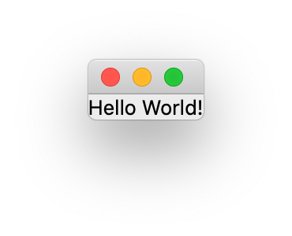

# 安装

可以通过 PyPA 使用 `pip` 安装 Qt for Python，包名为 `pyside6`。在下面的示例中，我们创建一个 `venv` 环境，并在其中安装最新版本的 Qt for Python：

```sh
mkdir qt-for-python
cd qt-for-python
python3 -m venv .
source bin/activate
(qt-for-python) $ python --version
Python 3.9.6
```

环境创建好后，我们继续使用 `pip` 安装 `pyside6`：

```sh
(qt-for-python) $ pip install pyside6
Collecting pyside6
Downloading [ ... ] (60.7 MB)
Collecting shiboken6==6.1.2
Downloading [ ... ] (1.0 MB)
Installing collected packages: shiboken6, pyside6
Successfully installed pyside6-6.1.2 shiboken6-6.1.2
```

安装完成后，可以在 Python 交互式提示符中运行一个 *Hello World* 示例来测试：

```sh
(qt-for-python) $ python
Python 3.9.6 (default, Jun 28 2021, 06:20:32) 
[Clang 12.0.0 (clang-1200.0.32.29)] on darwin
Type "help", "copyright", "credits" or "license" for more information.
>>> from PySide6 import QtWidgets
>>> import sys
>>> app = QtWidgets.QApplication(sys.argv)
>>> widget = QtWidgets.QLabel("Hello World!")
>>> widget.show()
>>> app.exec()
0
>>>
```

该示例会显示如下所示的窗口。要结束程序，关闭窗口即可。



