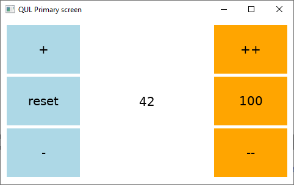

# 与 C++ 集成

## C++ 部分

为了演示 Qt for MCUs 中 C++ 与 QML 的连接，我们将创建一个持有整数值的简单 ``Counter`` 单例（singleton）。注意我们从 ``struct`` 而不是 ``class`` 开始。这在 Qt Quick Ultralite 中是常见做法。

该单例将被一个如下图所示的小型 UI 使用。



``Counter`` 结构体提供了一个属性 ``value``，以及修改该值的方法 ``increase`` 和 ``decrease``，还有一个 ``reset`` 方法。它还提供了一个信号 ``hasBeenReset``。

<<< @/docs/ch20-qtformcu/src/cppintegration/counter.h#global

从 Qt 过来的开发者会觉得这很奇怪。这正是 Qt for MCUs 展现其主要差异的地方。这里没有 ``QObject`` 基类或 ``Q_OBJECT`` 宏，取而代之的是一组来自 ``Qul`` 的新类。在这个具体例子中，基类是 ``Qul::Singleton`` 类，它在 QML 世界中创建一个可全局访问的单例。我们还使用 ``Qul::Signal`` 类来创建信号，用 ``Qul::Property`` 类来创建属性。所有公有的、非重载的成员函数都会自动暴露给 QML。

::: tip
要创建一个可从 QML 实例化的元素（而不是单例），请使用 ``Qul::Object`` 基类。
:::

然后使用 CMake 宏 ``qul_target_generate_interfaces`` 把该结构体暴露给 QML。下面你可以看到 ``CMakeLists.txt``，它基于 Qt Creator 生成的文件，并添加了 ``counter.h`` 和 ``counter.cpp`` 文件。

<<< @/docs/ch20-qtformcu/src/cppintegration/CMakeLists.txt#generate_interfaces

现在，继续看 ``Counter`` 结构体的实现。首先是 ``value`` 属性，我们用 ``value`` 和 ``setValue`` 函数来访问和修改实际的值。在我们的例子中，属性持有一个 ``int``，但与普通 QML 引擎一样，类型会[在 C++ 与 QML 之间映射](https://doc.qt.io/QtForMCUs/qtul-integratecppqml.html#type-mapping)。

这在下面展示的构造函数中被用到，它把初始值设为零。

<<< @/docs/ch20-qtformcu/src/cppintegration/counter.cpp#ctor

``increase`` 和 ``decrease`` 函数看起来很相似。它们使用 getter 和 setter，而不是直接与值交互。

<<< @/docs/ch20-qtformcu/src/cppintegration/counter.cpp#incdec

``Counter`` 还有一个信号。该信号由名为 ``hasReset`` 的 ``Qul::Signal`` 实例表示。信号以函数签名作为模板参数，所以要创建携带一个整数的信号，请创建 ``Qul::Signal<void(int)>``。在本例中，信号不携带任何值，因此它被定义为 `void(void)`。要发射该信号，我们只需像调用普通函数一样调用它，如下面的 ``reset`` 函数所示。

<<< @/docs/ch20-qtformcu/src/cppintegration/counter.cpp#reset

## QML 部分

QML 代码产生如下图所示的简单用户界面。


我们将分三部分来看这个 UI。首先是基本结构以及到 ``Counter.value`` 的绑定：

```
import QtQuick

Rectangle {
    width: 480
    height: 272

    Column {
        // Left buttons goes here
    }

    Column {
        // Right buttons goes here
    }

    Text {
        anchors.centerIn: parent
        text: Counter.value;
    }
}
```

如你所见，``Text`` 元素的 ``text`` 属性绑定到 ``Counter.value``，和所有 QML 中一样。

现在，来看左侧的按钮。它们用于调用通过 ``Counter`` 单例提供的 C++ 方法。``PlainButton`` 是我们用来创建这些简单按钮的一个 QML 元素。它允许你设置文本、背景色以及 ``clicked`` 信号的处理器。如你所见，每个按钮都在 ``Counter`` 单例上调用相应的方法。

<<< @/docs/ch20-qtformcu/src/cppintegration/cppintegration.qml#left

右侧的按钮直接从 QML 修改 ``Counter.value``。这样做是可行的，但对 C++ 是不可见的。C++ 没有简单的方式来监视某个属性是否发生了变化，因此如果需要 C++ 端做出反应，推荐使用 setter 方法，而不是直接修改属性值。

<<< @/docs/ch20-qtformcu/src/cppintegration/cppintegration.qml#right

以上展示了如何从 C++ 提供单例，以及如何在 C++ 与 QML 之间进行函数调用、发射信号、共享状态（属性）。

## 重新审视 CMake 文件

``CMakeLists.txt`` 文件对你来说可能很眼熟，但有一些技巧需要讨论。

首先，要把一个 C++ 类暴露给 QML，请使用 ``qul_target_generate_interfaces``，例如：

```
qul_target_generate_interfaces(cppintegration counter.h)
```

另一半，即 QML 文件，使用 ``qul_target_qml_sources`` 宏来添加。如果你有多个 QML 文件，像下面这样逐一列出即可：

```
qul_target_qml_sources(cppintegration cppintegration.qml PlainButton.qml)
```

另一个有趣的方面是，我们在构建一个没有编写 ``main`` 函数的 C++ 项目。这由 ``app_target_default_main`` 宏处理，它向项目中添加了一个参考的 main 实现。当然，如果你需要更多控制，可以用自定义的 ``main`` 函数替换它。

```
app_target_default_main(cppintegration cppintegration)
```

最后，链接的库不是标准的 Qt 库，而是 ``Qul::`` 系列库，例如：

```
target_link_libraries(cppintegration
    Qul::QuickUltralite
    Qul::QuickUltralitePlatform)
```

        
::: tip 链接
在 qt.io 上的延伸阅读：
* [集成 C++ 与 QML](https://doc.qt.io/QtForMCUs/qtul-integratecppqml.html)
:::
