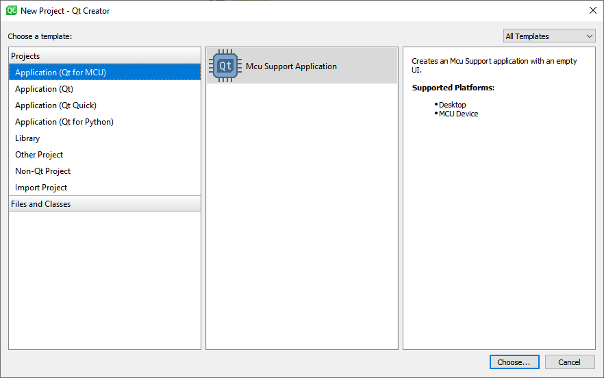
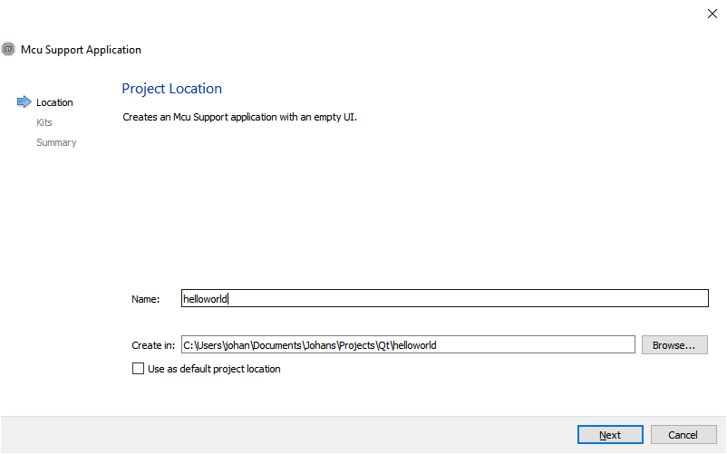
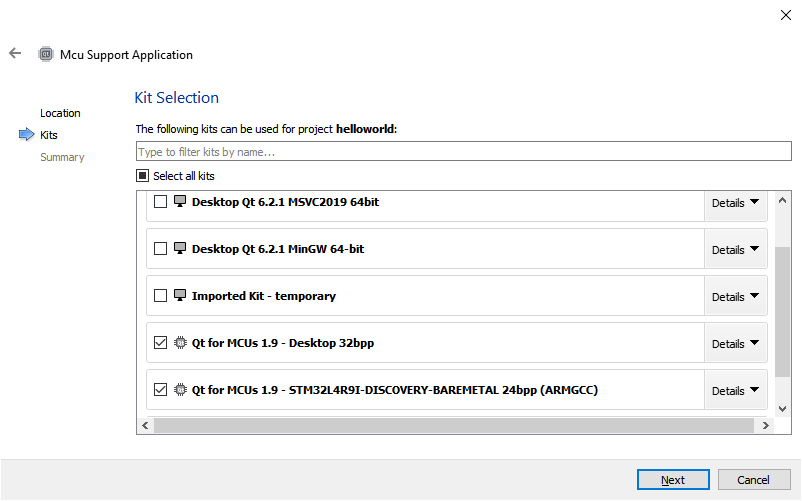
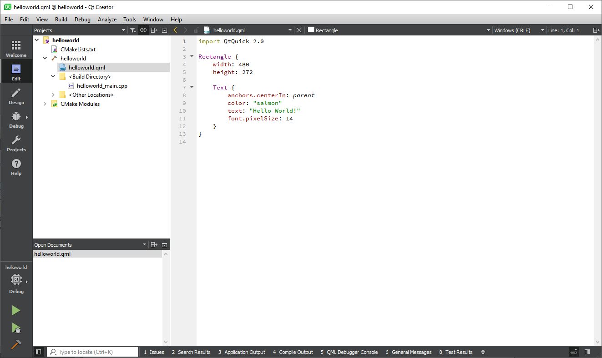
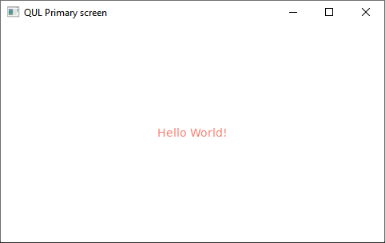
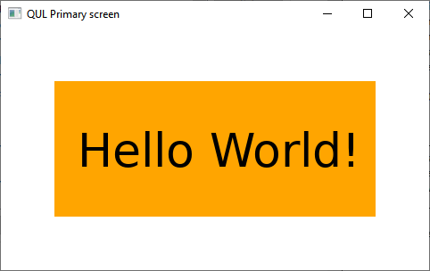
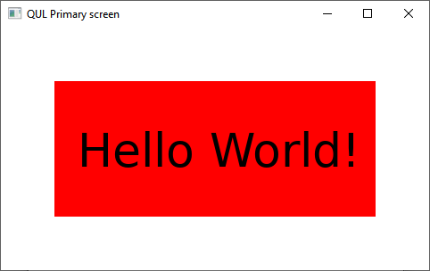
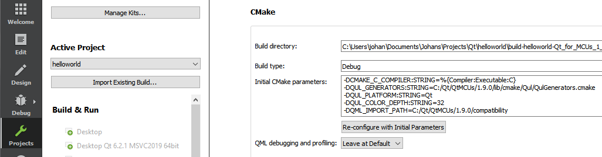

# Hello World——面向 MCU

由于 Qt for MCU 的环境搭建可能有些棘手，我们先从一个类似 _Hello World_ 的示例开始，以确保工具链可以工作，并借此讨论 Qt Quick Ultralite 与标准 Qt Quick 之间的基本差异。

首先，我们需要在 Qt Creator 中创建一个 Qt for MCUs 项目，以获得进入系统的 C++ 入口点。使用 Qt Quick Ultralite 时，我们无法使用像 ``qml`` 这样的常规运行时。这是因为 Qt Quick Ultralite 会连同所有资源的优化版本一起被翻译成 C++，然后构建成目标可执行文件。这意味着不支持 QML 之类的动态加载——因为目标设备上并没有运行解释器。



我把项目命名为 ``helloworld``。你可以随意挑选自己的名字。唯一会变化的是项目的入口 QML 文件名。



另外，创建项目时请确保选择 Qt for MCUs 构建套件（kit）。



再经过几个配置页面后，你会得到如下所示的项目。



基本项目搭建完成后，在桌面上运行该项目，确认你能得到如下图所示的窗口。



既然我们知道安装可以工作了，把 ``helloworld.qml`` 中的 QML 替换为下面所示的代码。我们会在下面逐行讲解这个示例，但请先为你的 _Qt for MCU Desktop_ 目标构建并运行它。结果应该是一个形如代码下方截图的窗口。

<<< @/docs/ch20-qtformcu/src/helloworld/helloworld.qml#global



点击橙色矩形，它会渐变为红色。再次点击，它会渐变回橙色。



现在，让我们从 Qt Quick 的视角来看这些源代码并做比较。

首先，Qt Quick Ultralite 会忽略 import 语句后的版本号。自 Qt 6 起，Qt Quick 也支持省略版本号来做到这一点，所以如果你可以不用版本号并且需要兼容性，请确保省略版本号。

```qml
import QtQuick
import QtQuickUltralite.Extras
```

在场景的根部，我们放置了一个 ``Rectangle``。这是因为 Qt Quick Ultralite 不提供默认的白色背景。通过把 ``Rectangle`` 作为根，我们确保自己控制场景的背景色。

```qml
Rectangle {
    width: 480
    height: 272
```

下一部分，即可点击的 ``Rectangle``，是直白的 QML，其中把一些 JavaScript 绑定到 ``onClicked`` 事件上。Qt for MCUs 对 JavaScript 的支持有限，因此请确保让这类脚本保持简单。你可以在本节末尾的链接中阅读到具体的限制。

```qml
    Rectangle {
        id: rect
        anchors.fill: parent
        anchors.margins: 60

        color: "orange"
        Behavior on color {
            ColorAnimation { duration: 400 }
        }

        MouseArea {
            anchors.fill: parent

            onClicked: {
                if (rect.color == "red")
                    rect.color = "orange";
                else
                    rect.color = "red";
            }
        }
    }
```

最后，文本使用 ``StaticText`` 元素来渲染，它是面向静态文本的 ``Text`` 元素的一个版本。这意味着文本可以只渲染一次，甚至可以预渲染，这在基于 MCU 的小型系统上可以节省大量资源。

```qml
    StaticText {
        anchors.centerIn: parent
        color: "black"
        text: "Hello World!"
        font.pixelSize: 52
    }
}
```

在 Qt Creator 中，你会注意到 ``StaticText`` 元素周围出现警告。这是因为 Qt Creator 假定你正在使用 Qt Quick。要让 Qt Creator 感知 Qt Quick Ultralite，你需要把 ``QML_IMPORT_PATH`` 设置为你的 Qt for MCUs 兼容性模块的路径。你可以在 CMakeLists.txt 文件中或在项目设置里完成这一配置。标准 Windows 10 安装的项目设置如下所示。



除上述内容外，还有更多差异。例如，Qt Quick Ultralite 的 ``Item`` 类以及随之的 ``Rectangle`` 类缺少许多在 Qt Quick 中能找到的属性。例如，``scale`` 和 ``rotation`` 属性缺失。它们只对特定元素可用，比如 ``Image``；在那里它们通过 ``Rotation`` 和 ``Scale`` 类型而不是属性来提供。

再进一步看，Qt Quick Ultralite 总体上提供的 QML 元素更少，但受支持的类型在持续增加。其意图是让所提供的类型覆盖目标设备的用例。你可以在下面提供的链接中阅读到这一点以及一般的兼容性问题。

::: tip 链接
在 qt.io 上的延伸阅读：
* [Qt Quick Ultralite 与 Qt Quick 的对比](https://doc.qt.io/QtForMCUs/qtul-qtquick-differences.html)
* [Qt Quick Ultralite Controls 与 Qt Quick Controls 的差异](https://doc.qt.io/QtForMCUs/qtul-qtquick-controls-api-differences.html)
* [已知问题与限制](https://doc.qt.io/QtForMCUs/qtul-known-issues.html)
:::
