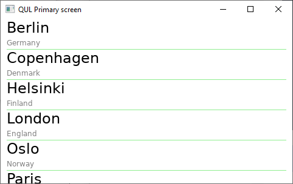
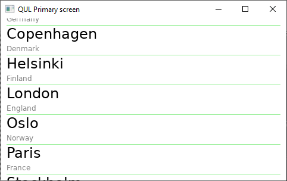
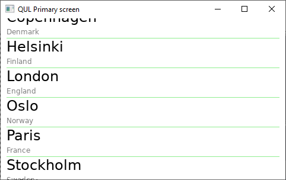

# 使用模型

在 Qt Quick Ultralite 中，可以使用 ``ListModel`` 元素在 QML 中创建模型。也可以——并且更有意思一些——从 C++ 创建模型。这让你能够把数据列表从 C++ 暴露给 QML，并为列表中的每一项实例化用户界面元素。其搭建方式与普通 Qt Quick 非常相似，不过基类和接口更为有限。

在本章中，我们将创建一个欧洲城市列表，列出城市的名称以及城市所在的国家。城市将显示在一个 ``ListView`` 中，如下图所示：



## C++ 部分

要在 Qt Quick Ultralite 中创建模型，我们需要做的第一件事是用一个 ``struct`` 定义每个列表项的数据。对于这个结构体，我们还需要提供一个 ``==`` 运算符。下面展示的 ``CityData`` 结构体做的就是这件事。注意在 Qt Quick Ultralite 中我们使用 ``std::string`` 而不是 ``QString``。其假定使用 UTF-8 编码。

<<< @/docs/ch20-qtformcu/src/cppmodel/citymodel.h#data

数据类型准备好后，我们声明 ``CityModel`` 结构体，它继承自 ``Qul::ListModel``。这让我们可以定义一个可从 QML 访问的模型。我们必须实现 ``count`` 和 ``data`` 方法，它们与 ``QAbstractListModel`` 类中的相应方法相似但并不相同。我们还使用 `CMake macro ``qul_target_generate_interfaces`` 来让这些类型对 QML 可用。

<<< @/docs/ch20-qtformcu/src/cppmodel/citymodel.h#model

我们还为 ``CityModel`` 结构体实现了一个构造函数，用数据填充 ``m_data`` 向量。

<<< @/docs/ch20-qtformcu/src/cppmodel/citymodel.cpp#global

## QML 部分

在示例中，我们把模型显示为可滚动的列表，如下图所示。



QML 代码完整展示如下：

<<< @/docs/ch20-qtformcu/src/cppmodel/cppmodel.qml#global

示例首先实例化 ``cityModel``。由于模型不是单例，它必须从 QML 实例化。

然后，委托 ``cityDelegate`` 被实现为一个 ``Component``。这意味着它可以被 QML 实例化多次。模型数据通过附加属性 ``model.name`` 和 ``model.country`` 来访问。

最后，``ListView`` 元素把模型和委托组合在一起，得到本章截图中所示的列表。



QML 中一个有意思的方面是 ``Text`` 元素的字体是如何配置的。``unicodeCoverage`` 属性让我们可以告诉 Qt Quick Ultralite 编译器自己希望能够渲染哪些字符。在指定固定字符串时，Qt Quick Ultralite 工具链会生成只包含我们打算使用的那些字形的最小字体。然而，由于模型会提供动态数据，我们需要告诉字体自己预期会使用哪些字符。

渲染完整字体时，你有时会遇到如下样式的警告：

```
[2/7 8.8/sec] Generating CMakeFiles/cppmodel.dir/qul_font_engines.cpp, CMakeFiles/cppmodel.dir/qul_font_data.cpp
Warning: Glyph not found for character "\u0000"
Warning: Glyph not found for character "\u0001"
Warning: Glyph not found for character "\u0002"
Warning: Glyph not found for character "\u0003"
Warning: Glyph not found for character "\u0004"
Warning: Glyph not found for character "\u0005"
Warning: Glyph not found for character "\u0006"
Warning: Glyph not found for character "\u0007"
...
```

这些警告可以放心忽略——除非你确实打算显示所涉及的字符。
