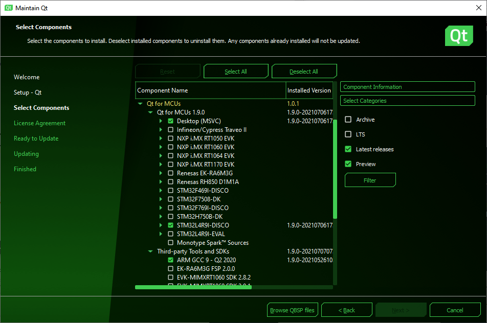
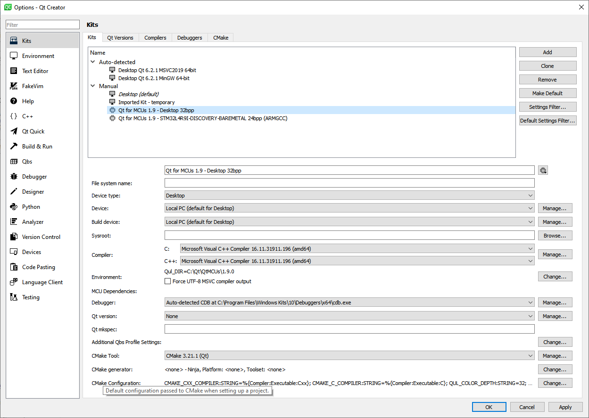
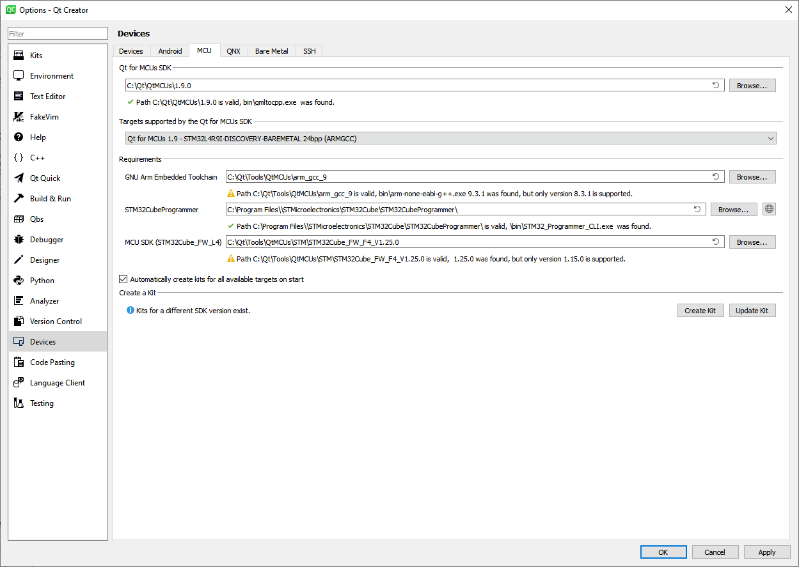

# 搭建环境

[Qt for MCUs](https://doc.qt.io/QtForMCUs/index.html) 支持来自 NCP、Renesas、ST、Infinion/Cypress 等公司的多种评估板。这些评估板适合入门，帮助你尝试与特定 MCU 的集成。最终，你很可能需要为自己的具体硬件调优某个平台定义（platform definition），例如配置 RAM、FLASH 的容量以及屏幕配置。

除了开箱即用地支持多种 MCU 之外，Qt for MCUs 还支持运行在 FreeRTOS 上或直接跑在裸机上，也就是没有操作系统。由于 Qt for MCUs 专注于图形前端部分，它没有文件系统之类的类。这一切都必须来自底层系统。因此，如果你需要更复杂特性的支持，FreeRTOS 是一个选择。

至于开发环境，不同的评估板配有不同的编译器，所以 Qt for MCUs 的安装步骤会因你所面向的 MCU 以及所选择的编译器不同而略有差异。例如，ST 的评估板同时支持 GCC 和 IAR，而另一些评估板则使用 Green Hills MULTI 编译器。从 Qt 的角度，官方支持的开发主机是 Linux（x86_64 上的 Ubuntu 20.04 LTS）或 Windows（x86_64 上的 Windows 10）。在 Windows 上，请注意受支持的 MSVC 编译器是 2017 和 2019 版本——不是最新的版本。请务必按照 [qt.io 上最新的安装说明](https://doc.qt.io/QtForMCUs/qtul-setup-development-host.html)来搭建可用的环境。

环境搭建完成后，你可以在 Qt Creator 的 _Tools - Options..._ 菜单项下，找到作为 _Kits_ 出现的受支持评估板，以及 _Devices - MCU_ 下的相关条目。

::: tip
如果在 Tools 下找不到 MCU 选项卡，请确认 Qt for MCUs 插件（McuSupport 和 BaremetalSupport）在 _Help - About Plugins..._ 下可用并已启用。
:::

::: tip 链接
在 qt.io 上的延伸阅读：

* [受支持的评估板](https://doc.qt.io/QtForMCUs/qtul-supported-platforms.html)
* [平台移植指南](https://doc.qt.io/QtForMCUs/platform-porting-guide-introduction.html)
:::
