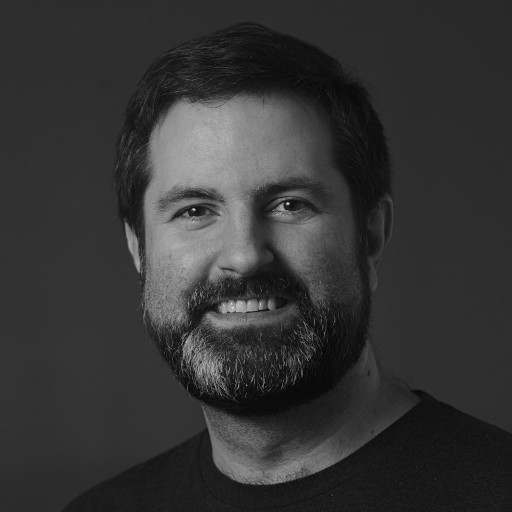
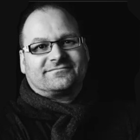

# 作者

The Qt 6 Book 由一个作者团队写就。他们是：

## Johan Thelin

Johan 是一名系统架构师，从事汽车解决方案的开发。他在基于 Linux、Qt 等技术打造设备方面拥有二十多年的经验。他为多家报刊和博客撰写文章，在众多会议上发表演讲，并就如何构建软件和软件组织提供建议。作为自由与开源方案的坚定拥护者，他创办并组织了 [foss-north 会议](https://foss-north.se)。

你可以在 [LinkedIn](https://www.linkedin.com/in/johanthelin)、[他的博客](http://www.thelins.se/johan/blog/) 和[他的主页](http://e8johan.se) 上了解更多关于 Johan 的信息。

## Jürgen Bocklage-Ryannel

Jürgen 是 ApiGear 的首席执行官。ApiGear 是一款协作式机器接口设计工具，让团队能够协作设计软件接口，并提供自动化的监控与仿真解决方案。

他是 Pelagicore AG 的联合创始人，在那里担任首席用户界面架构师，负责 Daimler MBUX 的早期版本。

他目前专注于一种由 API 驱动的工作流，用于为不同平台设计并创建用户体验与底层服务之间的接口。

你可以在 [LinkedIn](https://www.linkedin.com/in/jryannel/) 上了解更多关于 Jürgen 的信息。

## Cyril Lorquet

Cyril 是比利时公司 [Eunoia Studio](https://www.eunoia.be) 的联合创始人兼首席执行官，帮助各组织将其专业知识转化为软件产品。自 2009 年以来，他一直在不同领域（建筑、医疗、水文、市场营销……）从事软件产品方面的工作——其中多个都涉及 Qt。他骨子里是一名软件工程师，热衷于设计流程、软件开发和变更管理。

你可以在 [LinkedIn](https://www.linkedin.com/in/cyrillorquet) 上了解更多关于 Cyril 的信息。
